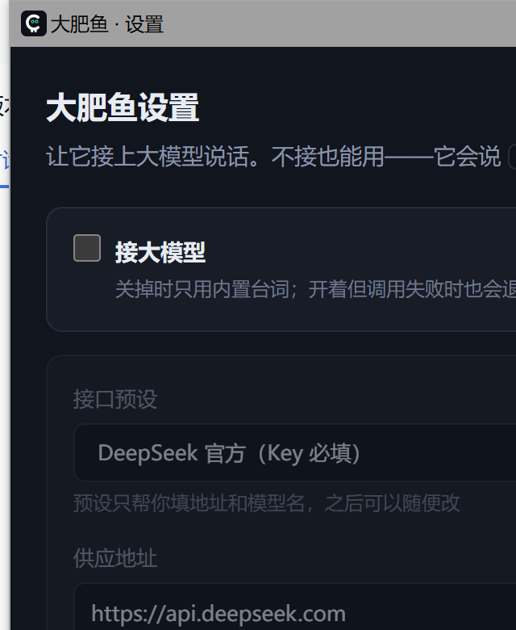

# Blue Fish Deskpet · 大肥鱼桌宠

> **接手这个项目的 AI 请先读 `..\HANDOVER.md`**（交接文档）：两个副本的关系、踩过的坑、
> 当前状态和待办都记在那里。这份 README 是写给用户看的。
>
> 软件叫 **Blue Fish Deskpet**（图标徽标上的那条鱼）；**她本人还叫「大肥鱼」**——
> 右键菜单顶上、台词、人设里都是这个名字。想让她本人也换成 Blue Fish Deskpet，
> 改 `pet.cjs` 的 `INIT.bot.name` 和 `llm.cjs` 的默认人设即可。

一条 DeepSeek 大肥鱼站在桌面上：会自己走动、会被戳、能被拎起来甩、会冒气泡说话。
**全部反应都在本地**（语音也是本地合成），只有可选的本地模型会用到 Ollama。

它现在会做的事：**戳 / 抚摸 / 拖拽 × 7 个部位**各自反应 · 呆毛和"耳朵"会跟着情绪动 ·
摸够几下它会**举一张选择卡问你** · **知道你在不在忙**（系统空闲）、**眼神跟着鼠标**、
**叫你的名字**、按时段换台词 · **记得你**（认识多少天、聊过几次、各项互动次数、你上次说的话）。

> **出处与credit**：桌宠窗口、鲸鱼模型和页面都从 **Coopanion** 搬来（Cortico 那一整套
> World / 事件总线 / terminal / CUA / 遥测 / pnpm 扩展一个都没带），我们的改动集中在
> `resources\app\*.cjs` 和 `lines.cjs`；对上游文件本身的六处改动都在 `tools\patch-assets.mjs` 里，
> 一眼能看全。图标由 `tools\make-icons.py` 从 `resources\app\web\icon-source.png` 生成。


---

## 跑起来

**在一台新机器上**（Windows 10/11，需要网络，合计约 450 MB 下载）：

最省事的一条路 —— **双击 `首次安装.bat`**。它会依次装配运行时（约 110 MB）和本地语音
（约 40 MB），最后跑一遍验收，成功就直接把桌宠拉起来。已经装好的部分会跳过，重复双击也安全。

想自己掌控每一步就用这三条命令：

```powershell
cd <这个仓库>\DeepSeekPet
powershell -ExecutionPolicy Bypass -File tools\setup-runtime.ps1   # 下载官方 Electron 44.4.4（约 110 MB）
powershell -ExecutionPolicy Bypass -File tools\check-runtime.ps1   # 验收：期望 all checks passed
powershell -ExecutionPolicy Bypass -File tools\setup-tts.ps1       # 下载本地语音（约 40 MB，可以跳过）
```

然后双击 **`启动大肥鱼.bat`**。

> `setup-runtime.ps1` 最后会**自动调 `tools\patch-exe.ps1`**，把 exe 的名字与图标换成
> Blue Fish Deskpet（需要下 1 MB 的 rcedit；那步失败不影响运行，有网时再跑一次就行）。
> **每次重装运行时都要重跑 patch-exe** —— 新解包的 exe 会把它盖掉，所以脚本里已经串好了。
> 已经自己下过 Electron 的话：`-Zip <electron-v44.4.4-win32-x64.zip 的路径>` 可省掉下载。

> 这个项目原本长在 `D:\pet\DeepSeekPet\`：那是**能跑的那一份**，源码在工作区里，
> 改完源码用 `tools\deploy.ps1 -To <可运行目录>` 同步过去。新机器上不需要这种双副本 ——
> 下面那条工作区权限的坑只对 AI 代理的工作区成立。

> **为什么不在这个工作区里跑？** 桌宠必须放在 `D:\Blue fish's work\` **之外**。
> 这个工作区里的文件会被 AI 沙箱写入两条额外的 Windows 权限项，Chromium 的沙箱初始化
> 撞上它们就以 `0x80000003` 静默崩溃——不建窗口、不写日志、什么都不提示。
> 详情见文末「为什么它不能放在工作区里」。

想开机自启：把 bat 的快捷方式丢进 `shell:startup`（Win+R 输入 `shell:startup`）。

> 双击 **`BlueFishDeskpet.exe`** 若弹出「Windows 已保护你的电脑」，那是 SmartScreen 对未签名
> 程序的例行提示：点「更多信息」→「仍要运行」一次即可。**平时用 bat 启动**，bat 不触发它。

## 怎么玩

| 动作 | 结果 |
|---|---|
| 戳一下 | 有反应（表情 + 气泡）。**戳哪儿不一样**：头 / 肚子 / 鳍 / 尾巴 / 裙子各有一套话；在同一个地方连戳会升档（第一次 → 又戳 → 够啦够啦），换个地方戳就重新按那个部位答 |
| 在它身上**抚摸**（不按下，来回蹭） | **摸着的时候它一直有反应**：脸红、眯眼、冒爱心、呼噜声一路续着；三段递进——刚摸上转过头 → 摸舒服了（约 1.5 秒）→ 摸太久（肚子/鳍/尾巴更早）就"够了啦"缩一下。摸哪儿也分开（头 / 肚子 / 鳍 / 尾巴 / 裙子） |
| **按住拖**（抓哪儿就从哪儿拎） | 抓**头/后颈**竖直垂着（老样子）· 抓**手**斜着挂在手上 · 抓**脚** **倒吊** · 抓**鳍**侧挂 · 抓**尾巴** **整个人平躺/趴平在尾巴下面**（尾巴被拽高）· 抓**裙子**歪着挂；拎着甩会跟着摆、甩得快有挣扎声，**拎超过 1.4 秒**它会吭一声，松手落地也按部位说一句 |
| 拖到另一块屏 | 窗口跟着过去 |
| 悬停 | 只在边上冒出一个**对话**按钮（打字跟它说话）。别的动作都在右键菜单里，两处不重复 |
| 托盘图标 | 显示 / 隐藏 / **设置…** / 打开日志 / 关闭 |
| 右键桌宠 | 上面一排：暂停 / **打开设置** / **音色…** / 退出；下面一排是全部动作：**对话** / 语音输入 / 行为模式 / 夜间模式 / 声音 / **自动** / 藏起来 |

> **双击不再打开打字框了**：连点两下本来就是在戳它，双击会抢同一个手势。打字用悬停那个**对话**按钮。

### 抚摸：摸着的时候它一直有反应

把鼠标放到它身上、**不按任何键**、来回蹭——这就是"抚摸"。判定的是**往复**（1.2 秒内方向反转
≥2 次、累计位移 ≥60px；单向顺毛划够 130px 也算），所以**轻轻摸就够**，不用搓。

摸着的时候是**连续反馈**，不是"隔一会儿闪一下"：

| 时间 | 它什么样 |
|---|---|
| 刚摸上 | 转过头来（惊讶），说一句「唔……?」 |
| 0.3 秒起 | 脸红上来了、呼噜声一段接一段续着、身体不乱走 |
| 约 1.5 秒 | 眯眼、冒爱心（说得出一句「呼噜呼噜……」） |
| 摸太久 | 肚子/鳍/尾巴约 2.6 秒、头和裙子约 4 秒 → 「够了啦」+ 缩一下，然后 3 秒内不再理你 |

- **部位也分开**：摸头最好说话，肚子会"咯咯"、鳍会抖、尾巴会炸。部位判定见
  `web\pet-app.js` 的 `REGION_AT`（和"戳"共用同一张表）。
- **睡着时摸它只会做梦**，不会吵醒（跟以前一样，只是现在好触发了）。
- **按住左键摸不算**：按住+移动在上游就是"拎起来"那个手势。
- **手感旋钮全在** `web\pet-app.js` 的 `STROKE_CFG` 里（判定的时间窗/反转次数/位移门槛、
  三段各自的时长、呼噜和爱心的刷新间隔）。**三段各自的台词**在 `lines.cjs` 的 `petting` 里，
  按部位分组。

> 为什么要自己在页面里判：上游那套是"累计位移 > 320px 才反应一次"，而累计值每帧还按
> `exp(-dt*1.5)` 衰减——实测要**每秒来回搓三次、持续 1.4 秒**才有第一次反应，人手舒服的
> 0.5–1.5 Hz 抚摸**永远触发不了**。详见交接文档第 1.12 节。

### 拖拽：抓哪儿就从哪儿拎

**按住它身上的某个地方拖起来** —— 抓点会**一直贴在你的光标上**（捏着左手就一直捏着左手），
身体该怎么挂按抓到的部位来：

| 抓哪儿 | 挂成什么样 |
|---|---|
| 头 / 呆毛 / 后颈 | 竖直垂着（**老样子**，没变） |
| 上身 / 腰 | 也是竖直 |
| **左手 / 右手** | **斜着挂在手上**——左边抓就顺时针歪、右边抓就逆时针歪 |
| 左鳍 / 右鳍 | 侧挂得更厉害 |
| **尾巴** | **整个人平躺/趴平在尾巴下面**（转 100°），尾巴被拽在最上面；身子被拽长、**四肢乱舞**（美术那边 `held` 本来就会做的） |
| 裙子 / 腿根 | 歪着挂 |
| **左脚 / 右脚** | **倒吊**（转 165°） |

- **拎着甩**：身体会跟着摆动（甩得快还有一段挣扎的 squeak 声）；**拎超过 1.4 秒**它会吭一声
  （「放我下来啦……」，按部位不同）。
- **松手落地**会按"原来抓着哪儿"说一句（「手终于自由了。」）。
- 抓点在**按下那一刻**定格：拖起来之后光标早就滑走了，实时算会算成"你手滑过去的地方"。
- 顺手补了个坑：原来**点脚根本点不到**（命中圈是个半径 108 的圆，下沿只到脚踝上面），
  现在补了"下半身"那个圆，所以"抓脚倒吊"才点得着。
- 旋钮：`web\pet-app.js` 的 `GRAB_STYLE`（每个部位的悬挂角，正=顺时针）和 `REGION_AT`（部位分界线）；
  台词在 `lines.cjs` 的 `grabArea` / `holdArea` / `dropArea`。
- **挂得越"横"会拉得越长**：拎起来本来就纵向拉长 9%，现在按悬挂角加成（尾巴 100° ≈ 13%、脚 165° ≈ 15%）。
- **拖到屏幕底部不会钻到地板下面**：余量是按"当前倾斜角下身体最深的那一点"算的，
  所以躺平和倒吊时最低点换了部件（躺平时是外侧的鳍、倒吊时是头），它也跟着换。

> **尾巴那一档能做到的极限**：这具身体是**正面朝向**的部件图，所以给到 100° 也只是
> "**平躺着（侧倒）**"，**不是**真正的"脸朝下、看得见后脑勺"的俯卧——那要另画一张趴姿贴图。
> 想要更"瘫"一点就把 `GRAB_STYLE.tail.hang` 从 100 调大（90 = 完全水平，110–120 = 头垂得更低）。

### 它还会做这几件事

| | |
|---|---|
| **你不在就不吵你** | 系统 **4 分钟**没有任何输入（你在别处忙、或者人不在）→ 它只偶尔动一下、不找话；**你回来（空闲一归零）它会主动招呼一句**，不用你先碰它（以前那句"你回来啦"得你先戳它才说） |
| **看着你的鼠标** | 光标在它 **260px 以内**，眼神就跟着你走（原来只有鼠标正好压在它身上才跟——窗口是点击穿透的，等于没有） |
| **叫你名字** | 设置页填「你的名字」，它就会说「早安,XX。」「XX,你去哪了呀。」——**语音也念名字**，保存后立刻生效、不用重启 |
| **按时段说话** | 早/午/晚/深夜各有各的发呆话和犯困话；**半夜**戳睡着的它，那几句更迷糊 |
| **记得它站哪儿** | 关掉再打开，它还站在上次那个位置（存在 `data\pet-pos.json`，删掉就等于重置） |
| **「黏着你」这一档** | 右键菜单「行为模式」现在有**第四档**：光标跑远（>170px）它会走过去待着；离得近就照常自己发呆 |
| **锁屏 / 睡眠 / 电池** | 锁屏它跟着睡、解锁醒过来说一句；改成**电池供电**会念一句"记得插上"（一小时最多一次） |
| **连戳的音高** | 连戳时音效一级级往上走，第 5 下最尖（跟世界那套连击同一个 2.5 秒窗口） |

### 它记得你

它有一个很瘦的记忆文件（`data\pet-memory.json`），只记这么几样：

- **认识第几天**、来过几天、第一次见面是哪天；
- **聊过几次**、你上次打的那句话；
- **戳 / 摸 / 拎起来 / 放下** 各多少次；
- **最常被摸的地方**（摸够 5 次才敢这么说）；
- **你常在的时段**、你还让它安静过几次。

它平时**不显示任何数字**，只偶尔（**每天最多 2 句**）把里面的一件说出来：
「上次你说「今天好累」，还好吗?」「你最喜欢摸我头,对不对。」；认识的第 7 / 30 / 100 / 180 / 365 天
会特意提一句，隔了 3 天以上没见也会说声好久不见。

**想看全部**：托盘或右键 →「打开设置」→「**它的记忆**」那张卡片（只读），旁边有「**忘掉一切**」。

**它跟大模型说话时也知道自己的处境**：每轮都会附一小段「此刻」——现在几点、你们认识多久、
**它现在什么心情**、刚被摸了头还是刚被拎起来——所以本地 3B 也会说"你又摸我头"这种只有当事人才说得出的回答。

### 它有心情（不是一句台词，是一条会变的数）

记忆是"账本"，心情是"此刻"。两条轴都连续，存在 `data\pet-mood.json`：

| 轴 | 什么会让它涨 | 什么会让它掉 |
|---|---|---|
| **喜欢** | 摸它、跟它打字说话 | 狂戳、拎着不放、摔它、你很久不在 |
| **精神** | 白天你在、白天它就在 | 半夜、困久了、被折腾 |

两条轴都**慢慢回到中位**（半衰期约 2.4 小时），所以心情会自己淡下去，一次互动改不了它的性子。
由这两条轴推出**五档**，每档有自己的发呆台词和步调：

| 档 | 什么时候 | 看得出来吗 |
|---|---|---|
| **黏人** | 喜欢 > .74 且精神 > .6 | 发呆台词变黏、动作快一成、「黏着你」那一档会凑到离你 **90px** |
| **开心** | 喜欢 > .62 | 尾巴摆得欢、走得比平常快一点 |
| **安静** | 不特别高兴也不太累 | 就是平常那个它（**动作原速**） |
| **困倦** | 精神 < .36 | 动作和走路慢一成、发呆间隔稍长、台词打蔫 |
| **想你** | 喜欢 < .4 | 台词委屈、离你远一点（**240px**），你回来会先招呼你 |

> **速度只给 ±10%**（0.9~1.1 倍，中位 1.0）：一开始给的是 ±35%，实测**走路明显"滑"**——
> 走路是每帧都看得见的量，位移一变快、步伐节奏来不及跟，就像穿了溜冰鞋。
> 所以这条幅度是**故意压小的**；想再调就改 `mood.cjs` 的 `MOVE_MIN` / `MOVE_MAX`（见下面「想调」）。

- **看得见的地方**：发呆 / 犯困优先说当前心情那几句（`lines.cjs` 的 `mood.<档>`）；
  **「黏着你」那一档离你多近**、**动作快慢**都跟着心情走；跟模型说话时「此刻」里也带着它。
- **想看数值**：设置页「它的记忆」那张卡片头上就写着「现在的心情」——喜欢 66 · 精神 60 · 动作 1.02× · 黏你 140px。
- **想调**：手感全在 `resources\app\mood.cjs` 顶部——`EVENT`（每种互动加多少）、`PULL`（回归多快）、
  `AWAY_PULL`（你不在时掉多快）、`compute()` 那几条分界线、`MOVE_MIN/MAX`（动作倍率的范围，现在 0.9~1.1）。
  **清空记忆**（设置页「忘掉一切」）会顺手把它拉回中位，但心情本身**不是记忆**，不写进 `pet-memory.json`。

> 心情只影响**它自己找话说的那一路**（发呆、犯困、步调、距离）。戳一下、摸一下、拎起来这些
> **对刚才那一下的回话完全照旧**——不会因为"今天心情不好"就串台词。

### 它不说话的时候也是活的（小动作）

发呆与发呆之间，它会自己做些**不出声的小动作**（`pet.cjs` 的 `scheduleMicro`，22~52 秒一次）：

- **歪头**：头轻轻偏一下（那 1.7 秒里呆毛和两片鳍会**跟着惯性甩**，因为它们本来就是被"头转动速度"驱动的）；
- **换重心**：原地把重心挪一下（身体微转 + 下沉一点，两下）；
- **瞟一眼**：你光标在附近时，低头瞄一下你的鼠标（会真的走过去，所以只有它闲着时才做）。

**呼吸**一直在，而且跟着心情走：平时慢而深、**困倦时浅而慢**、精神好时深而快（`figure.js` 里
`bDepth` / `bRate` 两个系数；心情那层没接上时就是原来的幅度，一点不变）。

> 为什么不塞进"发呆"：发呆是有台词的大动作，而**"活着的质感"恰恰来自那些不出声的小动作**；
> 而且暂停、有选择卡举着、你在忙的时候它照样做小动作（只是不出声），这才是"她一直在那儿"。
> 手感旋钮：`pet.cjs` 的 `MICRO_MIN_MS` / `MICRO_MAX_MS` / `MICRO` 三个名字；
> 姿态幅度在 `pet-core.js` 的 `micro()`（时长）和 `figure.js` 那两行（角度/位移）。

### 它听得懂你话里的情绪（本地关键词，不花 token）

你打的字**先过一遍本地关键词表**（`pet.cjs` 的 `TONE`，纯正则、零延迟、不花 token），
认出"累 / 难过 / 生气 / 谢谢 / 夸它 / 关心它 / 开心"七种，然后：

1. **先回一句这个情绪该说的话**（`lines.cjs` 的 `emotion.<桶>`）：说"今天累死了"它会说
   「累了就先歇会儿吧,我在这儿。」而不是等你接完模型那句；
2. **给模型的人设里塞一句提示**：`【你这句的情绪】用户听起来很累，说点安慰的，别提要求。`
   —— 这样本地 3B 也不会对着一个很累的人讲道理。

**优先级是有意的**（改 `TONE` 的顺序就改优先级）：累 > 委屈 > 生气 > 谢谢 > 夸它 > 关心 > 开心。
因为"累死了但总算搞定了"这种句子，先认出累才对。**读不出来是常态**（比如"今天几号"），
读不出就完全按原来的路走。日志里会留一行 `听出情绪:tired（本地关键词，不花 token）`。

### 换装（接口已经接好，等新衣服）

右键菜单里的「**换装…**」现在能打开一页服装界面（`web\dress.html`），**但现在只有「原版」能穿**：

- 上游那 8 套**配色**（ChatGPT 银白、Claude 赤陶…）**故意不做**——你要的是"更多服装"，不是换色；
- 清单里那两格「（预留）」是**看得见的占位**，点它会告诉你"还没有贴图"，而不是没反应。

**以后加一套新衣服就三步**：贴图放进 `web\whale\`（自己一个目录）→ 在 `model.json` 里加一条 →
把 `resources\app\dress.cjs` 的 `OUTFITS` 里那一格的 `id`/`label` 填上、`ready` 改成 `true`。
**接口、窗口、清单都是为这件事准备的，到时候不用再改一遍 UI。** 换装记录在 `data\dress.json`
（跟着 `DSP_LOG_DIR` 一起被隔离，自检不会动你真实的选择）。

### 呆毛和「耳朵」也会动

它的呆毛和脑侧那两片鳍（台词里叫"鳍"，看着其实就是耳朵）**一直是活的**：

- **闲置**：呆毛慢慢晃（±5°），两片鳍**不同频率**地轻扇（±4.5° / ±4°）——不同频才不像一个整体；
- **情绪**：开心 / 被爱时呆毛**和尾巴一起**晃得最欢（共用同一份"兴奋度"），生气时鳍高频抖，困了、难过会耷下来；
- **每约 10 秒**，它会**抖一下耳朵**（一个很短、很脆的脉冲）。

> 上游原本只有固定 ±2° / ±1.5° 的微动，而 **1° 在它身上只有 0.3 像素**，所以看着是死的。
> 幅度旋钮在 `web\whale\figure.js` 那三行；**同一个改动也写在 `tools\patch-assets.mjs` 第 4 处**
> —— figure.js 是会被"重新抽取"覆盖的文件，所以两边必须一起改（不然重抽一次动画就没了）。

### 它会问你（摸久了会举一张选择卡）

**触发条件是"抚摸"，不是点击**：把鼠标放到它身上、**不按任何键**、来回蹭（一次要蹭够 320 像素左右、
每 2.5 秒最多算一次）。**戳（按一下松开）永远不触发**——那是另一套手势（连击升级那套）。
摸够 **3 下**（**摸头算两下**——那是它最喜欢的），它就会主动问一句（比如「要不要我陪你待一会儿?」），
卡片上给你两个选项：**点一下，或者按数字键 1–9**。你选完，**它照着你选的做**：

- 选到「我在忙」这种选项，它会**安静几分钟**：不自己找话、也不自动说话，只偶尔动一下。
  但你主动跟它说话、摸它，它照样回——安静的是**它自己起的话头**。
- **卡片举着的时候它一句话都不说**（摸它只有表情、动作和音效）。这是必须的：页面见到任何
  一条新气泡都会把举着的卡收掉，所以这几秒它得让位给那张卡（实测踩过——卡片刚出来就被一句
  "蹭"的回话顶掉了，屏幕上只闪一下，看着像"从来没触发过"）。
- 卡片举着 **20 秒**没人选，它会自己找台阶下（「……算了，当我没问。」）并把卡收掉。
- 这些问题是**本地的、不花 token**，也不进对话历史（跟「自动说话」不一样，那条要接模型）。
- 问题和选项写在 `lines.cjs` 的 `ask` 里，加问题就往那里加（页面最多认 9 个选项）。

### 「自动」按钮：让它自己找话说

右键菜单里的**自动**（一个聊天气泡 + `auto` 角标）打开之后，**接了模型的前提下**，它每隔
**一分钟**自己跟模型要一句话说出来——不用你先开口。规矩：

- **只有接上模型才有效**：没接、或者这次没调通，就安静地跳过（不会硬凑一句内置台词）。
  这样它不会在你没配模型的时候自己刷屏。
- **你刚说完话就不插嘴**：一分钟内你打过字或戳过它，它就等下一轮。
- **睡着或暂停时不说话**：跟其它气泡一样。
- **不污染上下文**：自动说的话**不进**对话历史，所以它不会拿自己刚才闲扯的内容当成
  "你问过的问题"；每次只发人设 + 一句提示词。
- **温度调高到 1.05**：小模型不加这个会一遍遍重复同一句话。想更跳脱/更稳重改
  `pet.cjs` 的 `AUTO_CHAT_TEMPERATURE`。
- 开关**存在 `config\settings.json` 的 `autoChat`**，重启后还是上次那样；右键菜单里也有同一个开关。

> 它自己也常常答得很短——比如 3B 实测会说"在守护你，小主。"。想让话多一点就把人设里的
> "不超过 20 个字"放宽，或者把 `pet.cjs` 里 `AUTO_CHAT_PROMPT` 的字数上限改掉。

---

## 接大模型



**不接也能用**——它会说 `lines.cjs` 里的内置台词。想让它真的会聊，两个地方都能打开设置：

- **右键托盘图标 → 设置…**
- **右键桌宠 → 打开设置**（那个菜单里还能暂停 / 退出）

选个预设、填 API Key、点 **「测试连接」**。通了会显示耗时和它回的第一句话；不通会告诉你
差在哪：Key 不对、地址多写了 `/chat/completions`、本地模型没启动、还是超时。

| 预设 | 供应地址 | 默认模型 | Key |
|---|---|---|---|
| DeepSeek 官方 | `https://api.deepseek.com` | `deepseek-chat` | 必填 |
| 本地 Ollama | `http://127.0.0.1:11434/v1` | `qwen2.5:7b-instruct-q4_K_M` | 不用 |
| OpenAI | `https://api.openai.com/v1` | `gpt-4o-mini` | 必填 |
| OpenRouter | `https://openrouter.ai/api/v1` | `deepseek/deepseek-chat` | 必填 |
| xAI Grok | `https://api.x.ai/v1` | `grok-2-latest` | 必填 |
| 自定义 | 你自己填 | 你自己填 | 看情况 |

（预设的地址清单抄自 Coopanion 的 provider 文档。）走的是**一套 OpenAI 兼容的
`/chat/completions`**，所以 LM Studio、vLLM、one-api、硅基流动这类兼容端点，选「自定义」
填地址就能接。

**存哪**：`config\settings.json`，和 `data\` 平级。`data\` 是随时可删的运行时垃圾，
`config\` 是你的设置。**API Key 是明文存的**——本机单用户的小工具，不会发到别处；
想换个地方放，设环境变量 `DSP_CONFIG_DIR`。

**改完不用重启**：下一句话就生效。设置里还能改**人设**（system 提示词）和「一次最多生成」
——本地小模型建议 256，让它写 2000 token 桌宠就得等好几分钟。

**它怎么把回复变成气泡**：先按句号/问号切成最多 3 个气泡（一句一个气泡才像在说话，一整段
堆在一起像念稿），第一句按语气配表情。等模型的时候它会露出思考的表情；**模型挂了会退回
`lines.llmFailed` 的内置台词**，不会变成哑巴，具体原因写在 `data\pet.log` 里。

### 气泡什么时候说、说几条（应答链）

同一个时刻屏幕上只有一个气泡，所有气泡都从一条队列里排队出去。三条规矩：

| 规矩 | 数值 | 为什么 |
|---|---|---|
| **合并** | 同一类操作在 0.22 秒内算一批 | 狂点十下只出一个气泡，但连点的档位照样升到「够啦够啦」——不合并的话十下就是十条 |
| **限速** | 两个气泡之间至少隔 1.2 秒 | 一次爆发的操作不会变成连珠炮 |
| **过期** | 触发类回话排队超过 2.5 秒就不说 | 那是对几秒前那一下的回话，现在冒出来只会让人觉得"它答的不是我做的事"；问候、发呆、**模型回答**没有期限 |
| **上限** | 队列最多 3 条 | 再多就先扔掉旧的回话（`react`），不动跟时刻无关的话 |

连点完**停手之后就彻底安静**——队列里没有"过一会儿再冒一句"的来源；本地 3B 实测模型往返
不到 1 秒，所以打字问它也不会出现"回答来得太晚、跟刚才的操对不上"。

### 本地模型很慢？先看时间花在哪

实测这台机器（Ryzen 7 4800U，CPU 推理）跑 `qwen2.5:7b-instruct-q4_K_M`：

| | 总计 | 加载模型 | 读提示词 | 生成 |
|---|---|---|---|---|
| **冷**（模型被卸载后） | 17.8s | **11.0s** | 1.8s | 1.4s |
| **热**（模型还在内存里） | **1.7s** | 0.01s | 0.19s | 2.1s（13 token @ 6.2 tok/s）|

所以"第一次问要等十几秒"几乎全是在**把 4.7 GB 权重从硬盘读进内存**，不是算力不够。
三个已经做进代码的优化：

1. **`keep_alive`** —— Ollama 默认 5 分钟没人问就把模型卸掉，下次又重读一遍。现在请求会带上
   `keep_alive`（**实测 Ollama 的 OpenAI 兼容端点也认这个字段**），模型就一直待着。代价是
   常驻内存（7B 约 5 GB）；填 `-1` 就是永不卸载。
2. **启动时预热** —— 桌宠一起来就悄悄问一句，把那十几秒挪到你说话之前（日志里会有
   `本地模型预热完成 …ms`）。
3. **默认 `maxTokens` 从 256 降到 128，人设从"不超过 60 字"收到 40 字** —— 生成速度是
   **6.2 token/秒**，写多少字就要等多少秒，128 就是约 20 秒的上限。

热了之后还嫌慢的话，**换小模型比调参有用得多**（同一台机器实测）：

| 模型 | 生成速度 | 加载 | 常驻内存 |
|---|---|---|---|
| `qwen2.5:7b-instruct-q4_K_M` | 6.2 tok/s | 11.0s | 5.1 GB |
| `deepseek-r1:1.5b` | **24.3 tok/s** | 3.7s | 1.3 GB |

1.5B 快 4 倍、省 4 GB，但 `deepseek-r1` 是**推理模型**，回答又长又正式
（实测："您好！请问有什么可以帮助您的？如果您有任何问题或需要信息，请随时告诉我！"），
不适合桌宠。想要那个速度就拉一个**非推理**的小模型：`qwen2.5:1.5b-instruct-q4_K_M`
或 `qwen2.5:3b-instruct-q4_K_M`，然后在设置里改模型名即可。

另外核对过：**显卡没被用上**（显存 0.00 GB，全在内存里）。Ryzen 4800U 的 Vega 核显不在
Ollama 的加速名单里，而它和 CPU 抢的是同一份内存带宽，这条路不值得追。

---

## 它现在会说什么

台词全在 **`resources\app\lines.cjs`**，一共 **302 条、39 个顶层桶**，分门别类放好。逻辑在
`resources\app\pet.cjs`，只管"什么时候说哪一句"。

它不是随机播报，会看情况：

| 情况 | 它的反应 |
|---|---|
| 开机 | 按**时间段**问候：早上 / 下午 / 晚上 / 深夜各 4 句 |
| **「自动」打开着** | 接了模型时**每隔一分钟自己说一句**（见上面「自动」那一节） |
| 戳一下 | 5–6 句轮着来（`poke.first`） |
| 连着戳 2–4 下 | 语气变差，换成 `poke.again` |
| 连戳 5 下以上 | 真烦了，`poke.tooMuch`（"哼,不理你了。"） |
| 鼠标在它身上蹭 | `pet`（"呼噜呼噜……"） |
| 蹭**睡着的**它 | `petAsleep`（"（在梦里蹭了蹭）"），不会吵醒它 |
| 拎起来 | `grab`（"要掉下去了要掉下去了!"） |
| 放下 | `drop`（"呼,吓死我了。"） |
| 甩出去 | `throw`（"世界在转……"） |
| 摔狠了 | `crash`（"眼冒金星……"） |
| 离开 8 分钟以上再回来 | 先来一句 `returnFromAway`，再接上面的反应 |
| 没人理 4 分钟 | `drowsy`（"眼皮好重……"） |
| 没人理 6 分钟 | **自己躺下睡**，睡着期间一声不吭 |
| 睡着时戳它 | `pokeAsleep`（"唔……几点了……"） |
| 睡着时打字 | 站起来 + `wakeUp`，然后正常回答 |
| 闲着没事 | 每 35–90 秒动一下；约 1/3 概率说句 `idle`，1/6 概率**溜达到你鼠标那儿** |

同一个数组里的台词是**抽签不重复**的：一轮里每条都会轮到，轮完才重新洗牌，所以不会
同一句话连着来两次。

**加台词**：直接往 `lines.cjs` 对应数组里加 `{ text: '……', actions: ['happy'] }` 就行，
不用碰任何逻辑。`text` 建议 6–20 个字（气泡是 20 字/秒打出来的）。加错了 `test\smoke.cjs`
会告诉你——它会检查文字非空、动作名认不认识。

> **接了模型之后**，你打字它就问模型（走上一节的设置），回复切成气泡说出来；**没接、或者
> 这次没调通**，就退回 `lines.reply` 里的内置台词。两种情况下"戳它 / 拖它 / 闲着"的反应
> 都还是上面那张表——那些永远是内置台词，不花 token，也不会因为断网变傻。

想换内置台词的表现，改 `pet.cjs` 里的 `replyTo(ws, text)`；想换问模型的方式，改
`llm.cjs` 里的 `chat()`（例如加 `temperature`、换成流式、换成分角色的多轮格式）。
两条路互不影响。

`actions` 可用名字 —— 表情：`neutral happy wink love shy surprised angry sad sleepy thinking`；
动作：`stand jump hop look turn nod shake spin sit sleep dizzy walk run`。

---

## 改它

| 想改什么 | 改哪儿 |
|---|---|
| **它说什么** | `resources\app\lines.cjs` —— 全部台词，加就完了 |
| **接哪个模型 / Key / 人设** | 界面里改（托盘「设置…」），或直接编辑 `config\settings.json` |
| 多久动一次 / 多久犯困去睡 | `pet.cjs` 顶部的 `IDLE_MIN_MS` / `DROWSY_AFTER_MS` / `SLEEP_AFTER_MS` |
| 连击判定多快算连击 | `pet.cjs` 的 `POKE_COMBO_MS` |
| **自动说话多久一次 / 说多长 / 多跳脱** | `pet.cjs` 的 `AUTO_CHAT_MS` / `AUTO_CHAT_QUIET_MS` / `AUTO_CHAT_PROMPT` / `AUTO_CHAT_TEMPERATURE`；默认开关在 `INIT.autoChat` |
| **气泡多久说一句 / 几条合成一条 / 多久算过期** | `pet.cjs` 顶部的 `BATCH_MS` / `SAY_GAP_MS` / `TTL_MS` / `QUEUE_MAX` |
| 离开多久算"你回来啦" | `pet.cjs` 的 `RETURN_AFTER_MS` |
| 模型的回答怎么变成气泡 | `pet.cjs` 的 `beatsFor()`（切句）和 `moodOf()`（挑表情） |
| 大小 | `pet.cjs` 里 `INIT.scale`，`1` → `1.5` 大一半 |
| 走动频率 | `pet.cjs` 里 `INIT.roam`：`off` 不乱动 · `calm` 多待着 · `free` 常走动 |
| 白/夜配色 | `INIT.theme`：`'dark'` / `'light'` |
| 悬停按钮 | `INIT.hoverButtons`，默认**只有 `chat`（对话）**——其余动作都在右键菜单里，不重复摆。想加回可选 `auto` `roam` `theme` `sound` `hide`（最多 6 个） |
| **戳/蹭哪个部位说什么** | `lines.cjs` 的 `pokeArea` / `petArea`（五个部位各一桶）；**分界线**在 `web\pet-app.js` 的 `REGION_AT`（"离哪个锚点最近算哪个"，坐标抄自 whale\model.json 的 pivots） |
| **抚摸的手感** | 判定与节奏：`web\pet-app.js` 的 `STROKE_CFG`（往复时间窗/反转次数/位移门槛、三段各自的时长、呼噜与爱心的间隔）；三段台词：`lines.cjs` 的 `petting`（按部位分组） |
| **拖拽怎么挂** | 每个部位的悬挂角：`web\pet-app.js` 的 `GRAB_STYLE`（正=顺时针；左右半边自动换号）；部位分界线：同文件的 `REGION_AT`；台词：`lines.cjs` 的 `grabArea` / `holdArea` / `dropArea` |
| **呆毛 / 耳朵的动静** | `web\whale\figure.js` 里那三行（`finTwitch`、`wagAmp * 8 * …`、`st.ahoge` / `st.finNear` / `st.finFar`）；**同一个改动也必须在 `tools\patch-assets.mjs` 第 4 处**，重抽才不丢 |
| **你叫什么** | 设置页「你的名字」→ `config\settings.json` 的 `user`；台词里写 `{name}`（`lines.cjs`），替换点在 `pet.cjs` 的应答链里 |
| **它多久算"你不在"** | `pet.cjs` 的 `AWAY_SEC`（默认 240 秒，系统空闲时长）；顺带 `AWAY_POLL_MS` 是查询间隔 |
| **黏着你走多近** | `web\pet-core.js` 里 `roam === 'cling'` 那段（默认 170px 以外才追） |
| **它站在哪儿** | `INIT.rememberPosition` + `data\pet-pos.json`（最多 20 秒写一次）；换显示器觉得位置怪就删掉那个文件 |
| **记忆里记什么 / 每天说几句** | `resources\app\memory.cjs`（字段与 `SAY_PER_DAY`）；说法在 `lines.cjs` 的 `memoryMilestone` / `memoryAway` / `memoryWords` / `memoryArea` / `memoryHour`。**删掉 `data\pet-memory.json` 就等于重来** |
| **心情的两条轴 / 五档 / 动作倍率 / 黏人多近** | `resources\app\mood.cjs`（`EVENT` 每种互动加多少、`PULL` 回归多快、`AWAY_PULL` 你不在时掉多快、`compute()` 分界线）；各档台词在 `lines.cjs` 的 `mood.<档>`。**删掉 `data\pet-mood.json` 就等于回到中位** |
| **小动作多久来一次 / 幅度** | `pet.cjs` 的 `MICRO_MIN_MS`/`MICRO_MAX_MS`/`MICRO`；姿态在 `pet-core.js` 的 `micro()` 与 `figure.js` 的 `microTilt`/`microStep` 两行；呼吸深浅节奏是 `figure.js` 的 `bDepth`/`bRate` |
| **情绪识别认哪些词 / 优先级** | `pet.cjs` 的 `TONE`（正则表，**数组顺序就是优先级**）与 `TONE_HINT`；各桶台词在 `lines.cjs` 的 `emotion.<桶>`（键必须和 `TONE` 一致，自检盯着）。**加一种情绪 = 加一行 + 一个桶** |
| **服装清单 / 以后加新衣服** | `resources\app\dress.cjs` 的 `OUTFITS`（`ready:false` = 还没贴图）；窗口是 `web\dress.html`，换装记录 `data\dress.json`。上游那 8 套配色**故意没带** |
| **给模型的"此刻"** | `pet.cjs` 的 `contextLine()`（拼那几十个字）+ `llm.cjs` 的 `chat(…, context)`（并进 system） |
| **它多久问一次 / 问什么** | **触发是"抚摸"不是点击**；摸够几下：`pet.cjs` 的 `ASK_AFTER_PETS`（默认 3，摸头算两下）· 间隔：`ASK_COOLDOWN_MS`（默认 3 分钟）· 卡片举多久：`ASK_TTL_MS`（默认 20 秒，这段时间它闭嘴）· 问题和选项：`lines.cjs` 的 `ask` |
| 右键菜单 | `INIT.bot`（`buttons` 里挑 `pause` `settings` `quit`） |
| **图标** | 原图是 `resources\app\web\icon-source.png`；改完跑 `python tools\make-icons.py` 重新生成 `app-icon.png`（256，窗口/任务栏）· `tray-icon.png`（64，托盘）· `avatar.png`（128，菜单人像） |
| **软件名** | `package.json` 的 `productName` + `pet-host.cjs` 的窗口标题/托盘提示 + `pet.html`/`settings.html`/`voice.html` 的标题。**注意**：`main.cjs` 里那个 `'… · 设置'` 字面量必须跟 `settings.cjs` 的窗口标题**一字不差**（自检里有一条专门盯着它） |

改完重启桌宠生效（右键托盘 → 关闭，再双击 bat）。

---

## 目录

```
DeepSeekPet/
├─ 首次安装.bat              新机器上先双击它：装运行时 + 语音，再自动验收
├─ 启动大肥鱼.bat            启动器
├─ BlueFishDeskpet.exe       Electron 44.4.4 运行时（官方 zip 改名而来；可再换图标）
├─ *.dll *.pak *.bin icudtl.dat locales/    运行时其余部分
├─ data/                     日志与 Chromium 状态（可整目录删除，等于恢复出厂）
│  ├─ pet.log                她的行为日志：出问题先看这里
│  ├─ pet-host.log           窗口与页面那一层的日志（含页面 JS 报错的堆栈）
│  ├─ pet-mood.json          心情（喜欢 / 精神两条轴）
│  ├─ pet-pos.json           她上次站的位置
│  └─ dress.json             换装记录
├─ config/                   ★ 你的设置（删了要重填）
│  └─ settings.json          接口地址、API Key、模型名、人设
├─ preview.png  settings.png
├─ HANDOVER.ROOT.md          交接文档（跟源码一起同步过来，记录当前这份到底是什么）
├─ CHANGES.ROOT.md           修改声明（AGPL-3.0 §5(a)）
├─ resources/app/            ← 应用本体
│  ├─ package.json
│  ├─ main.cjs               Electron 入口：单实例 + 起服务 + 开窗
│  ├─ server.cjs             127.0.0.1 上的 HTTP 静态服务 + WebSocket
│  ├─ pet.cjs                ★ 它的行为：什么时候说哪句、什么时候去睡、连击怎么升级
│  ├─ mood.cjs               ★ 心情：喜欢 / 精神两条轴 + 五档（黏人·开心·安静·困倦·想你）
│  ├─ dress.cjs              ★ 服装清单与换装记录（接口先占住，贴图以后再加）
│  ├─ lines.cjs              ★ 全部 302 条台词（39 个桶），想加就加
│  ├─ llm.cjs                ★ 接大模型：配置读写 + OpenAI 兼容调用 + 把报错说人话
│  ├─ store.cjs              ★ 小 JSON 文件的原子读写（先写 .tmp 再改名；配置/心情/记忆/服装都走它）
│  ├─ settings.cjs           设置窗口 + IPC（含「它的记忆 / 心情」「服装」两个窗口）
│  ├─ settings-preload.cjs   设置页面能碰到的全部能力（就这几个方法）
│  ├─ dress-preload.cjs      服装页面能碰到的全部能力
│  ├─ log.cjs                data\pet.log
│  ├─ pet-host.cjs           桌宠窗口宿主（Coopanion 搬来；改了托盘菜单、图标与应用名，
│  │                         另加了窗口显示兜底、页面报错落盘、诊断日志轮转）
│  ├─ preload.cjs            页面与窗口宿主之间唯一的桥（多了个 `report` 用于报错落盘）
│  ├─ node_modules/ws/       WebSocket 实现（唯一第三方依赖，无子依赖）
│  └─ web/                   页面（Coopanion 搬来，只打了补丁）
│     ├─ pet.html pet.css pet-core.js
│     ├─ diag.js             页面全局错误捕获（最先加载；把异常送回主进程写文件）
│     ├─ pet-app.js          改动：诊断日志默认关掉、部位判定、抚摸、按部位拖拽…（后几处还没进补丁脚本）
│     ├─ dress.html          服装页
│     ├─ settings.html       设置界面（自带样式和脚本，单文件）
│     ├─ avatar.png          右键菜单里的人像（我们自己的图，由 tools\make-icons.py 生成）
│     ├─ rig/rig.js          类 Live2D 渲染器（WebGL2，网格 + 形变器）
│     └─ whale/              ★ 大肥鱼模型
│        ├─ figure.js        把鲸鱼接到 pet-core 的骨骼、弹簧、表情绘制
│        ├─ model.json       骨架/枢轴/部件/表情定义（只留 deepseek 配色）
│        ├─ tex/             25 张部件贴图（头发、裙、鳍、尾、脸…）
│        └─ feat/            25 张五官贴图（眼、嘴、腮红…）
├─ test/smoke.cjs            自检 219 项：文件、台词库、设置、模型链路、记忆、心情、图标、连点合并…
└─ tools/                    重建与部署脚本（纯 ASCII，避免 PS 5.1 读成乱码）
   ├─ setup-runtime.ps1      装配 Electron 运行时（默认下载官方 Electron；-Source 复用本机 Coopanion）
   │                         最后会自动调 patch-exe.ps1
   ├─ patch-exe.ps1          把「Blue Fish Deskpet」这个名字与图标盖到 exe 上（rcedit）
   ├─ check-runtime.ps1      验收：运行时 / 应用 / 图标 / 语音 / 权限，逐条 ok 或 MISS
   ├─ setup-tts.ps1          装本地语音（sherpa 插件从 npm 下；语音模型 release 下，默认 CC0 的 chaowen）
   ├─ make-icons.py          由 web\icon-source.png 生成 png 与多尺寸 ico
   ├─ extract-pet.ps1        从 Coopanion 抽桌宠页面与鲸鱼模型
   ├─ patch-assets.mjs       对上游的六处改动（抽取脚本会调用它）
   └─ deploy.ps1             把源码目录同步到可运行目录
```

### 对上游只动了六处

`main.cjs` / `server.cjs` / `pet.cjs` / `lines.cjs` / `llm.cjs` / `settings.cjs` / `log.cjs`
是自己写的（约 1400 行），其余全是 Coopanion 的东西。改到上游的有六处，全在
`tools\patch-assets.mjs` 里，跑一次抽取脚本就会重新套用：

1. `pet-app.js` 的指针诊断日志默认关掉（`?diag=1` 打开）——它每秒写一行，会把真报错埋掉；
2. `model.json` 只留 deepseek 一套配色；
3. `pet-host.cjs` 的托盘菜单把点了 404 的「装扮…」换成「设置…」和「打开日志」；
4. `figure.js` 的呆毛与脑侧两片鳍加情绪振荡器；
5. `pet-host.cjs` 的窗口/托盘图标换成大肥鱼，标题与托盘提示改成 Blue Fish Deskpet；
6. `pet.html` 的页面标题。

> **加第 N 处的规矩**：给新改动**单独一次 `edit()` 调用 + 自己的 marker**（marker 必须是改完之后
> 文件里真会出现的那串字）。自检里有一条专门盯这件事。

上游那两个大文件（`pet-app.js` 59KB、`pet-core.js` 64KB）**故意没有精简**：里面确实带着用不到的
语音输入、带按钮的提问、装扮页、屏幕取色，但那些代码路径我们从不触发，运行时零成本；
动它们等于自己维护一个 fork，一升级就冲突。

---

## 从 Coopanion 搬了什么

**搬了**：桌宠窗口宿主（透明 / 点击穿透 / 置顶 / 多屏拖动 / 托盘）、桌宠页面与
pet-core 身体逻辑（走路、跳跃、拖拽、表情、气泡、打字、音效）、类 Live2D 渲染器 `rig.js`、
DeepSeek 大肥鱼的骨架与 50 张贴图。

**没搬**：Cortico core（World、事件总线、投递水位、run/incidents）、terminal world、
CUA world（操作电脑）、遥测、pnpm 扩展安装与 esbuild 编译、多 provider 抽象、
装扮页、语音输入（FunASR / sherpa-onnx）、以及其余 7 套配色（harness / chatgpt / claude /
gemini / qwen / kimi / minimax）。

**又删掉的**：`web` 从 10.5 MB 压到 1.4 MB（删了那 7 套配色，`model.json` 只留 deepseek 一条）；
`locales` 从 55 个语言包压到 2 个（en-US + zh-CN，1.1 MB）。

所以这一版**不会操作你的电脑**，也**不上报任何数据**。它默认只监听 `127.0.0.1`，
不往外发东西——**只有你自己在设置里接了大模型之后**，它才会往你填的那个地址发请求
（如果你填的是云端，那句话就出网了；填本地 Ollama 就完全不出本机）。

### 运行时的体积还能不能压

不能。约 320 MB 里 230 MB 是 Electron 那个 exe 本身（我们把它改名成 `BlueFishDeskpet.exe`），其余是 Chromium 的 dll / pak / ICU 数据。
我拿运行中进程的模块表核对过：`dxcompiler.dll`(24.5 MB)、`dxil.dll`、`d3dcompiler_47.dll`、
`vk_swiftshader.dll`、`ffmpeg.dll` **全部都被加载了**（大肥鱼是 WebGL2 画的，需要 D3D 着色器
编译），删任何一个都可能让它在别的机器上直接白屏。唯一没被加载的是 `vulkan-1.dll`（0.9 MB），
但它是 Vulkan 回退路径的一部分，为 0.9 MB 冒这个险不值得。

要更小只能换一个更小的 Electron 运行时，那是另一件事了。

---

## 自检与重建

```powershell
# 自检 219 项：页面文件、贴图、302 条台词、设置读写、模型链路（用假端点）、记忆、心情、图标、
#              补丁 marker、连点合并与过期、自动说话、连击升级、睡着状态、暂停恢复、目录穿越防护、
node test\smoke.cjs

# 看它实际会怎么说话（用当前配置，含人设；不需要 Electron）
node tools\tone.cjs
node tools\tone.cjs "今天好累啊"      # 也可以问你自己的话

# 重新装配运行时（默认下载官方 Electron 44.4.4 并自动调 patch-exe；-Zip 用本地 zip，
#                     -Source ..\Coopanion 则硬链接本机那份）
powershell -ExecutionPolicy Bypass -File tools\setup-runtime.ps1

# 验收：运行时 / 应用 / 名字与图标 / 语音 / 权限，逐条 ok 或 MISS（exit 0 = 全过）
powershell -ExecutionPolicy Bypass -File tools\check-runtime.ps1

# 单独重盖名字与图标（每次重装运行时之后都要重跑一次）
powershell -ExecutionPolicy Bypass -File tools\patch-exe.ps1

# 重新抽取桌宠页面与大肥鱼模型（并重新套用对上游的六处改动；需要本机有 Coopanion）
powershell -ExecutionPolicy Bypass -File tools\extract-pet.ps1

# 把源码目录同步到可运行的那份（两份副本别各改各的）
powershell -ExecutionPolicy Bypass -File tools\deploy.ps1 -To D:\pet\DeepSeekPet
```

自检里那节模型测试会自己起一个**假的 OpenAI 兼容端点**，把配置指到临时目录再跑一遍
「设置 → 调用 → 切气泡 → 说出口」，所以不需要真 Key，也不会动你的 `config\settings.json`。

---

## 排错

日志在 **`data\pet.log`**，每次启动都会写清版本、命令行、端口、页面是否连上。

**`data\pet-host.log` 是窗口与页面那一层的日志**（跟 `pet.log` 分开放，免得窗口的闲话埋掉她的行为）：
里面记着窗口什么时候显示/隐藏、是否置顶、位置，以及**页面里的 JS 报错（带堆栈）**。
**"她不对但日志看着一切正常"的时候，第一个该看的就是这个文件。**
（它会自己轮转：超过 2 MB 就把当前那份改成 `pet-host.log.1`，所以不会无限长大；
窗口状态的心跳只在**状态真的变了**时写一行，另外每 5 分钟留一次"我还活着"。）

| 现象 | 原因与处理 |
|---|---|
| 双击 bat 一闪而过，什么都没有 | 看 `data\pet.log` 在不在。没有日志说明 Electron 没起来 —— 见下面两条 |
| 从终端/编辑器里启动会静默退出 | 环境里有 `ELECTRON_RUN_AS_NODE`（DSH、VS Code 这类 Electron 程序会注入）。它会让这个 Electron 退化成纯 Node，不建窗口也不写日志。bat 里已经把它清掉了 |
| **日志也没有、进程也没有、退出码 `0x80000003`** | **应用放在了 AI 工作区里**，目录带着沙箱写入的额外权限项，Chromium 沙箱初始化直接崩。把整个文件夹复制到工作区外（`D:\pet\DeepSeekPet` 就是这样来的）即可；bat 的 `--no-sandbox` 兜底也能让它起来 |
| 双击 exe 弹「Windows 已保护你的电脑」 | SmartScreen 对未签名程序的例行提示。点「更多信息」→「仍要运行」一次；或干脆用 bat 启动 |
| 有日志但屏幕上没鱼 | 看日志里有没有「桌宠页面已连接」。没有就是端口/页面加载问题；有就看托盘菜单「显示桌宠」，并去 **`data\pet-host.log`** 看窗口那几行（显示/隐藏/坐标/是否置顶） |
| **她坐在那儿一动不动、点她也没反应（人还在、影子也在）** | **帧循环死了**：页面里的 JS 每帧抛错。去 `data\pet-host.log` 搜 `[页面异常]` / `[figure.draw 抛错]`，堆栈会指到具体文件行号。**这类错误 `node --check` 是查不出来的**（语法没问题、是运行期作用域问题） |
| **看不见她，但能互动、地上还有影子** | 影子/特效（`drawFx` 画进 `#fx`）和她的身体（canvas 画进 `#pet`）是**两条绘制路径**。所以"有影子没身体"基本就是身体那条路抛错了 —— 同样去 `pet-host.log` 找 `[figure.draw 抛错]` |
| **窗口存在、`isVisible` 也是 true，屏幕上就是没有** | 透明窗口靠 GPU 合成。先用 `DSP_DISABLE_GPU=1` 启动一次排除"GPU 的锅"；再去 `pet-host.log` 看心跳那几行（`visible/bounds/top`）与她是否被别的置顶窗口盖住 |
| 双击了但没反应，日志里是「已经有一条大肥鱼在跑了」 | 它本来就在跑（可能被别的窗口挡住或在托盘里）。现在这种情况会把已有的那条叫到最前面，不用管 |
| **打字它只回内置台词，不理你的话** | 设置里「接大模型」没勾上，或者 `config\settings.json` 里的 `enabled` 是 false |
| **它说「我好像接不上话了」** | 模型调用失败，退回内置台词了。日志里有确切原因（`模型调用失败（模型 @ 地址）:…`）；也可以到设置里点「测试连接」看细节 |
| **本地模型第一次问要等十几秒** | 那是在加载模型（7B 实测 11 秒），不是算力问题。设置里的「本地模型常驻」和「启动时预热」就是治这个的，见上面「本地模型很慢？」那一节 |
| **连点 / 拖拽之后还一直弹气泡** | **已经修好**：气泡走"应答链"（合并 / 限速 / 过期），连点或连续拖拽十几次也只会出一两个气泡，停手就安静。见上面「气泡什么时候说、说几条」 |
| **它答的话跟我做的事对不上** | 老版本把每次点击的回话都排进队列、隔几秒才说，看起来就像答错。现在触发类回话排队超过 2.5 秒直接丢掉；模型回答不设期限，但等的时候会亮思考表情 |
| **打开了「自动」它却不说话** | 它只在**接上大模型**时才自动说话（没接就安静地跳过）。另外：你刚说过话的一分钟内、它睡着时、暂停时都不说；日志里会写「自动说话:…」和「模型回复 …（自动说话）」 |
| 回话还是慢 | 生成速度是硬上限（7B 实测 6.2 token/秒）。把「一次最多生成」调小，或者换个更小的模型（3B 实测约 1 秒） |
| 想恢复出厂 | 删掉 `data\` 整个目录；连设置一起清就再删 `config\` |

---

## 为什么它不能放在工作区里

这一条是实测出来的，不是猜的。

把桌宠放在 `D:\Blue fish's work\` 里时，双击任何东西都是**彻底静默**：不建窗口、不写日志、
退出码 `0x80000003`（`STATUS_BREAKPOINT`，Chromium 内部 `CHECK` 失败的那种崩法），
连 `main.cjs` 的第一行都没执行到。

排查过程排除掉了：exe 损坏（与厂商版 SHA256 完全一致）、缺文件（运行时逐个哈希比对一致）、
locale 包、Chromium 配置残留、路径里的空格与单引号、文件夹名、SmartScreen 拦截。
最后用两个对照实验锁定：

1. 把**厂商自己的** `resources\app` 用目录联接放到我们的运行时下 —— 崩；
2. 把**整个文件夹**复制到 `D:\pet\DeepSeekPet`（工作区外）—— **无开关正常启动**。

差别只有 `icacls` 能看到的那两条权限项，工作区内的对象上多出来：

```
Deny   Everyone                        DeleteSubdirectoriesAndFiles
Allow  S-1-4-396511842-833225282       DeleteSubdirectoriesAndFiles, Write, Delete, Synchronize
```

（`S-1-4-*` 是 AI 沙箱自己的身份。）Chromium 在 Windows 上初始化沙箱时要给子进程配置目录权限，
撞上这两条就 `CHECK` 失败。`--no-sandbox` 跳过整段流程，所以能起来——那也是为什么
bat 的兜底能让它在工作区里跑，但**正路是把它放在工作区外**。

> 给 DSH 的反馈：工作区内由沙箱创建的对象会带上这两条权限项，放在里面的
> Electron 应用一律无法以默认（带沙箱）方式启动。

---

## 许可

- 本项目**整体**遵循 **AGPL-3.0-or-later**（见仓库根的 `LICENSE`）：它是
  [Pal-AI-Lab/Coopanion](https://github.com/Pal-AI-Lab/Coopanion) **0.1.13** 的衍生作品 ——
  桌宠窗口、页面与「大肥鱼」模型都从那里搬来。**这是修改版，不是原版**：
  改了什么写在仓库根的 [`CHANGES.md`](../CHANGES.md)，开发过程写在 [`HANDOVER.md`](../HANDOVER.md)。
- ⚠️ `resources/app/web/whale/` 的**贴图不在 AGPL 授权范围内**（上游明确声明：角色原设「溟月」、
  DeepSeek 女仆装二创参考 ZipZipPipe、贴图由 ChatGPT 生成、围裙上含各家商标图形）——
  想单独使用请自行确认权利。详见 `THIRD_PARTY_NOTICES.md`。
- 第三方组件：Electron（MIT）· sherpa-onnx（Apache-2.0）· ws（MIT）· onnxruntime（MIT）等，
  同样见那份 notices。
- **非官方、无关联**：与 DeepSeek / OpenAI / Anthropic / Google / 阿里云 / 月之暗面 / MiniMax
  均无隶属或认可关系。
