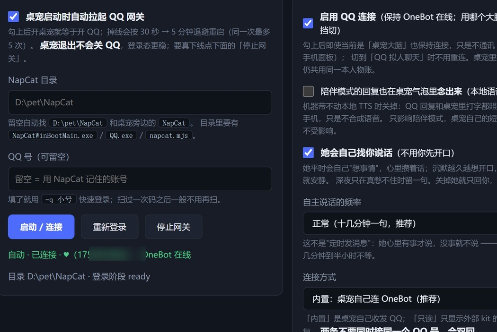

# Blue Fish Deskpet · 大肥鱼桌宠 v0.3

一只住在 Windows 桌面最底边的 DeepSeek 小鲸鱼女仆。会走动、被戳会有反应、能被拎起来甩、会说内置台词，
离线也能玩。v0.2 她学会了陪你玩球；**v0.3 她有了 QQ、有了记忆和自己的日子，还有一部能自己用的安卓手机。**


> 界面、台词、文档全是中文。自检 **2136 项 / 58 个区域**（约 1.5 分钟），纯 Node 就能跑，不用装 Electron。
>
> **这个包不带运行时**（Electron 解压后约 370 MB，下载约 110 MB）：解压后双击一次 `首次安装.bat` 自动下载，之后双击
> `启动大肥鱼.bat`。本地语音和安卓模拟器也不随包提供 —— 都是可选件，缺了照样能跑，
> 要装的话看 [安装与运行](docs/安装与运行.md)。

## 30 秒跑起来

| 步骤 | 做什么 |
|---|---|
| 1 | Windows 10 / 11 64 位，联网 |
| 2 | 双击 **`首次安装.bat`** → 下载官方 Electron 44.4.4（约 110 MB，SHA-256 校验；GitHub 慢会自动换国内镜像 npmmirror）→ 自动改名、盖图标、验收 |
| 3 | 双击 **`启动大肥鱼.bat`** → 她出现在屏幕最底边，托盘里有图标 |

- **不接大模型也能玩**：用内置台词和动作。想让她真的说话，右键她 →「设置」→ 填一个 DeepSeek API Key。
- **本地语音（可选，约 40 MB）**：首次安装时会问一次；跳过就是哑的，别的一切正常。
- 装完约 380 MB（其中运行时约 370 MB）；`data\` 会随聊天和记忆慢慢长大。

> **为什么 v0.2 有 527 MB、这一版只有 7.5 MB？解压之后到底要几步？**
> 见 **[体积与部署](docs/体积与部署.md)** —— 一张表拆完体积，一张表写清"只有 3 个地方需要你动手"，
> 以及"给维护者"的打包/验收清单。

## v0.3 更新了什么（相对 v0.2）

| | v0.2（2026-10-11） | v0.3（2026-11-14） |
|---|---|---|
| 她是谁 | 桌面上的小鲸鱼女仆 | 同左，另有一份「纯粹的人」人格，用在 QQ 里 |
| 陪伴 | — | **QQ 小号**：桌宠自己拉起网关、扫码登录、私聊/群聊、看图、发表情包、想说话就说话 |
| 记忆 | 认识多少天、互动次数 | **长期记忆**（BM25 + 摘要压缩）+ 人物账 + **她自己的账**（锚/账/证词/传）+ 想象 |
| 声音 | 本地 TTS | + **QQ 语音**（直连火山豆包语音合成 1.0，四个旋钮）+ **耳朵**（语音条 / 麦克风 / 语音对讲） |
| 手机 | 只读小面板 | **真安卓手机**（MuMu + adb）：会看屏、会滑、会开任何 App、会刷视频、会写日记、会自己玩 |
| 时间 | 只在自己那句里按时段 | 每轮消息最前面一行「【现在】2026-11-01 08:43 周日」，只给事实 |
| 自检 | 428 项 / 31 个区域 / ~124 秒 | **2136 项 / 58 个区域 / 约 1.5 分钟** |

逐条改动（含每笔的根因、真机数据、还差什么）见 **[CHANGES-v0.3.md](CHANGES-v0.3.md)**。

> ⚠️ 先说实话：**「她的想象」和「她的账（内核记忆）」这一版只是框架**——能跑、能看、能管，
> 但还很粗。差在哪、下一步怎么补，都写在 [CHANGES-v0.3.md 第 8 节](CHANGES-v0.3.md#8-还没做完还粗的地方诚实清单)。

## 她有什么

### 桌面上
- **三个手势 × 十五个部位**：戳 / 抚摸 / 拖拽，作用在头、呆毛、脸、嘴、肚子、手、鳍、尾巴、裙子、脚…各说各的话；
  抓哪儿从哪儿拎（抓手斜挂、抓脚倒吊、抓尾巴整个人趴平），丢出去还能在半空接住。
- **一直有反应**：脸红、眯眼、冒爱心、呼噜声；刚摸上 → 摸舒服了 → 够了啦，三段递进；摸够了她会举一张选择卡问你。
- **心情是连续的数**（love / energy 两轴）：影响台词、走路速度、表情；输赢会轻轻推动它。
- **次级动画**：发梢和尾巴晚 0.1 秒跟上、眨眼有睫毛阴影、呼吸起伏（困了浅而慢）、呆毛和耳鳍跟着情绪动。
- **长在桌面上**：采身后屏幕颜色，身后接近时描一圈和桌面反着的轮廓光，影子也按桌面色相染色。
- **她看得见你**：系统空闲 / 锁屏 / 睡眠 / 电池，眼神跟鼠标，按时段换台词，记得自己站的位置。
- **天气 ↔ 她**：雨打到她身上会溅、雪只积在三个美术锚点上并跟着她动、她走动会带起一阵风；环境音随天气淡入淡出。
- **陪她玩**：悬停时旁边 2×2 四个按钮（对话 / 玩球 / 天气 / 陪伴三挡）；自由玩球，或者进**弹弹乐**比赛
  （左右球门、按足球规则开球、1 秒庆祝、难度靠她真的读球）。
- **换装**：接口已接好，等新衣服（美术流水线暂停，见 v0.2）。

### QQ 里（陪伴模式）
- **网关管家**：桌宠自己拉起并看住 NapCat（无黑窗），设置页扫码 / 一键快速登录，掉线按 30 秒 → 5 分钟退避重启；
  **桌宠退出不关 QQ**，重开直接接管。
- **两套模型**：设置页「桌宠模型 / QQ 模型」两张独立的卡，可以同一个 Key，也可以分开。
- **看图**：QQ 里发图她真的看得见（`image_url`，不用本机视觉模型）；大图自动缩到最长边 1400。
- **表情包**：本地目录文件名就是关键词；能同步小号 QQ 收藏；她自己在回复里写 `[表情:晚安]` 就发；
  你发的图她说 `[收藏:关键词]` 就存下来。
- **自己开口**：不是定时器 —— 念头池（心里有没有事）× 动机分（沉默越久越想）× 闸门（刚聊完、你没回、深夜、上限）；
  频率三档（少 / 正常 / 多）；群聊不主动。
- **说话长短由她定**：不再限制"一两句"，想分几条就换行，一行一条（最多 6 条）。
- **引用回复识别、群聊只认 @、模型遥测、清图片缓存**、设置页里都能管。

### 她记得
- **长期记忆**：一条记忆一个 md，每 6 轮后台整理；BM25 检索 + 时间衰减；超过 160 条 / 12k token 就把最旧一批压成摘要，
  原文进 `archive/`。设置页有「长期记忆」面板：搜索 / 删除 / 立即整理 / 立即压缩。
- **人物账**（`people.json`）：关于**你**的 traits / facts；归属判定先判 him / her / none，她的性子不会被记成你的。
- **她自己的账**（`data/companion/self/`）：**锚**（她认下的事）· **账**（taste/stance/doing/want/change）·
  **证词**（她说过的话，带"当时什么滋味"）· **传**（「我这一周」）。右键她 →「她的账」可以看、删、手加一条、让她现在写一笔。
- **想象**：给她一个词，她每"看"一眼只添一件（看/听/闻/摸/温度/身体），**系统一个字都不描述**；
  浓度由代码数，不回想就淡（20 分 / 90 分 / 6 时 / 24 时）。「她的账」窗口第 4 张卡里能看、能删、能"让她想一个"。
- **对话流水 1200 轮**：每轮她看到 20 轮本会话 + 12 轮跨场合 + 检索到的长期记忆；裁剪前先归档。

### 她的声音与耳朵
- **QQ 语音**：直连火山「豆包语音合成 1.0」，音色是调好的混音（佩奇猪 40 · 撒娇学妹 20 · 魅力女友 40），
  设置里只有四个旋钮（语速 / 音量 / 音色 / 情感）；没有每日上限、也没有间隔；
  **"这条要不要用声音"由场景递话筒，"说什么、哪句说"仍由她写**。试听在「音色」窗口里，不发 QQ。
- **耳朵**：QQ 语音条转写、桌宠麦克风直接说话、一来一回的"语音对讲"（没有 QQ 语音通话接口，所以做成语音消息）；
  转文字用火山方舟 `doubao-seed-2-1-lite`，顺手听出语气。
- **本地语音**（v0.2 的能力，仍可选）：sherpa-onnx 离线合成，装了才出声。

### 她的手机（需要自己下模拟器）
- **真安卓，不是小面板**：MuMu 12 + 自带 adb，零依赖接管层（`phone-adb.cjs`）+ 操作员（`phone-agent.cjs`）。
- **第三挡**：桌宠旁边的三挡按钮，第三挡 = 真手机 —— 430×900 窗口贴在她旁边，页面上的只读镜像收起。
- **她真的会看**：每一屏都截图（640 宽，约 228 token）→ 按控件树 + 图做决定 → 先想 2~3 步再动手 →
  严格判"有没有进展"，两次没动就换招。
- **打开任何 App**：缓存 → 别名 → 当前屏 / 回桌面 / 抽屉里按字点 → 截图问坐标 → **验前台包名**；学到的记进 `apps.json`。
- **会刷视频、会搜东西、会点结果页**：读字 → 抽 3 帧 → 她自己判一次 → 想走就上滑。
- **会写日记**：随包带一个自己写的安卓日记本（`tools/diary-app/out/her-diary.apk`，193 KB），
  写 / 翻 / 删都能来；**连删 2 篇以上会提醒你**。
- **会自己玩**：需求条 → 想办一件事 → 先请示你 → 你点头就去 → 收尾一条回灌 + 一条日记；
  一天有额度（默认 90 分钟）、有冷却、有时段（22:30 后只读）。
- **预算**：一趟默认 20 步 / 180 秒 / 20 次模型调用 / 连续 2 次没反应就收。
- **她拍到的截图**：只在当轮请求里用，**不写进对话流水**；发的图只发主人私聊，一小时最多 6 张。

### 设置里能管什么
桌宠模型 / QQ 模型 / 她的声音 / 她的耳朵 / 长期记忆 / 表情包 / 清空图片缓存 / 清空陪伴记忆 /
她会自己找你说话（三档）/ QQ 连接（启动、重新登录、停止、二维码）/ 她的手机（第三挡）/
音色窗口（试听、重新读取配置）/ 她的账窗口（锚 / 账 / 证词 / 想的东西）。



## 目录

```text
DeepSeekPet_v0.3\
├─ README.md                       ← 你在这里
├─ CHANGES-v0.3.md                 v0.2 → v0.3 改了什么（含还差什么）
├─ 首次安装.bat                    一键：下载运行时（+ 可选本地语音）+ 验收
├─ 启动大肥鱼.bat                  启动器
├─ preview.png / settings.jpg      预览图
├─ LICENSE / THIRD_PARTY_NOTICES.md
├─ .gitattributes / .gitignore
├─ config\                         脱敏后的默认配置（Key 都是空的）
│   ├─ settings.json               桌宠：模型、台词开关、天气、球
│   ├─ companion.json              陪伴：QQ、模型、记忆、语音、手机
│   ├─ companion-role.md           角色卡（她是谁、怎么说话）
│   └─ voice-asr.json              耳朵：方舟语音识别
├─ docs\                           使用文档（8 份，见下）
├─ resources\app\                  应用本体（代码 1.5 MB + 美术 3.9 MB）
│   ├─ main.cjs / pet-host.cjs / server.cjs      Electron 主进程与本地服务
│   ├─ pet.cjs / lines.cjs / mood.cjs / memory.cjs / dress.cjs    桌宠行为、台词、心情、记忆、换装
│   ├─ llm.cjs / tts*.cjs / voice-config.cjs     模型与本地语音
│   ├─ companion*.cjs              陪伴模式：网关、OneBot、大脑、记忆、人格、声音、想象、自我
│   ├─ phone*.cjs / her-web.cjs / her-diary.cjs  她的手机：adb、操作员、屏、开 App、网、日记
│   └─ web\                        页面与鲸鱼模型、粒子、球、弹弹乐、设置、她的账、音色窗口
├─ test\                           自检：smoke.cjs + 58 个区域（纯 Node）
├─ tools\                          安装 / 验收 / 重建脚本（不含 119 MB 的语音模型包）
│   └─ diary-app\                  她的日记本（安卓源码 + 签好的 APK）
└─ data\                           首次运行后自动生成：日志、记忆、聊天流水、她拍的照片
```

## 装什么、从哪下

| 件 | 必须？ | 大小 | 怎么来 |
|---|---|---|---|
| Electron 运行时 44.4.4 | **必须** | ~110 MB 下载 / ~370 MB 装好（含语言包） | `首次安装.bat` 自动下（GitHub 或 npmmirror 镜像，SHA-256 校验） |
| 本地语音（sherpa-onnx + 音色） | 可选 | ~40 MB | `首次安装.bat` 里问一次；或 `powershell -File tools\setup-tts.ps1` |
| NapCat（QQ 网关） | 想连 QQ 才要 | 装好约 1.2 GB（含 QQ NT） | 自己下：<https://github.com/NapNeko/NapCatQQ/releases>（也可用 Lagrange 等任意 OneBot 11，见 [QQ 陪伴模式](docs/QQ-陪伴模式.md)） |
| MuMu 模拟器 12 | 想让她用手机才要 | ~1 GB | 自己下：<https://mumu.163.com>（见 [她的手机](docs/她的手机-模拟器.md)） |
| 她的日记本 APK | 想让她写日记才要 | 193 KB | **已随包**：`tools\diary-app\out\her-diary.apk` |
| DeepSeek API Key | 想让她真的说话 | — | <https://platform.deepseek.com> 自己申请，填进设置页 |

合计：**只玩桌宠约 380 MB；全功能（语音 + QQ + 手机）约 9.5 GB**，其中模拟器一个人占 7.7 GB。
完整的体积拆解和"解压后几步"见 [体积与部署](docs/体积与部署.md)。

## 文档

| 文档 | 什么时候看 |
|---|---|
| **[体积与部署](docs/体积与部署.md)** | 想知道为什么只有 7.5 MB、解压后要做什么、怎么确认装完整了（含维护者清单） |
| **[安装与运行](docs/安装与运行.md)** | 第一次装、换机器、装完起不来、想开机自启、想恢复出厂 |
| **[QQ 陪伴模式](docs/QQ-陪伴模式.md)** | 想让她在 QQ 里陪你：NapCat、扫码、两套模型、群聊、看图、表情包 |
| **[她的手机 / 模拟器](docs/她的手机-模拟器.md)** | 想让"她玩手机"：MuMu、adb、装日记本、第三挡、她自己玩 |
| **[语音与耳朵](docs/语音-两种.md)** | 本地语音 / QQ 语音 / 语音识别，三件事别搞混 |
| **[配置与数据](docs/配置与数据.md)** | 每个配置文件管什么、Key 放哪、数据在哪、怎么备份 |
| **[排错](docs/排错.md)** | 起不来、没声音、QQ 连不上、手机连不上、模型 503 |
| **[返回索引](docs/README.md)** | 上面几份的关系 |

## 许可与出处

- 本项目是 [**Pal-AI-Lab/Coopanion**](https://github.com/Pal-AI-Lab/Coopanion) **0.1.13** 的衍生作品，
  整体 **AGPL-3.0-or-later**（见 [`LICENSE`](LICENSE)）。**这是修改版，不是原版**；
  相对上游改了哪些文件、v0.2 之后又改了什么，见 [`CHANGES-v0.3.md`](CHANGES-v0.3.md)。
- ⚠️ **`resources/app/web/whale/` 的贴图不在 AGPL 授权范围内**：角色原设「溟月」（上善无形），
  女仆装二创参考 ZipZipPipe，贴图由 ChatGPT 按参考图生成，围裙上是各家公司的商标图形。
  单独使用这些图请自行确认权利 —— 详见 [`THIRD_PARTY_NOTICES.md`](THIRD_PARTY_NOTICES.md)。
- 第三方：Electron（MIT）· ws（MIT）· sherpa-onnx（Apache-2.0，可选）· NapCat（AGPL，独立程序）· MuMu（网易，独立软件）。
- **非官方、无关联**：与 DeepSeek / OpenAI / Anthropic / Google / 阿里云 / 月之暗面 / MiniMax / 腾讯 / 网易均无隶属或认可关系。

## 已知情况

- **未签名**：首次双击可能弹「Windows 已保护你的电脑」→ 更多信息 → 仍要运行。用 `.bat` 启动一般不弹。
- **只监听 `127.0.0.1`**：不对外开放端口，不触发防火墙弹窗。
- **不要把整个目录放在 AI 代理的工作区里**：那里的文件会带额外权限项，Chromium 沙箱会静默崩溃
  （`0x80000003`，没窗口没日志）。放到普通目录（比如 `D:\`）就好。
- **这一版不带**：Electron 运行时、本地语音模型、NapCat、MuMu 模拟器、换装素材。
  完整开发日志（`CHANGES.md` / `HANDOVER.md`）留在开发仓库，本包只带 v0.3 的更新说明。
- **「她的想象」和「她的账」是框架级**：能跑、能看、能管，但内容还很粗 —— 差距清单在
  [CHANGES-v0.3.md 第 8 节](CHANGES-v0.3.md#8-还没做完还粗的地方诚实清单)。
