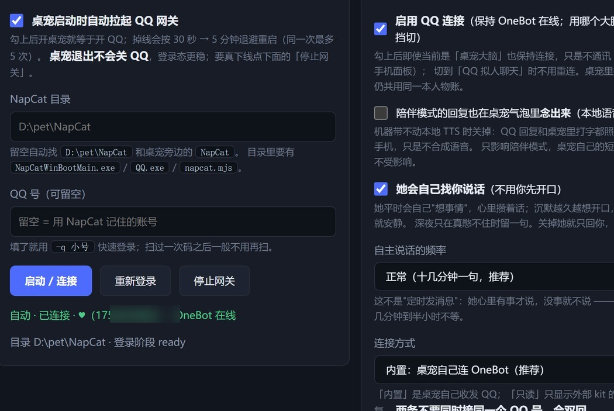

# QQ 陪伴模式

> 让她在一个 **QQ 小号**里跟你聊天：自己说话、看图、发表情包、想起来就找你。
> 这一套是**可选**的 —— 不接 QQ，桌宠本体照样能玩。
>
> 需要三样东西：一个 QQ 小号、[NapCat](https://github.com/NapNeko/NapCatQQ)（QQ 网关，免费开源）、
> 一个模型 Key。**本包不附带 NapCat**，要自己下。

## 为什么包里没有 QQ / OneBot？

`DeepSeekPet_v0.3` 只有 **7.5 MB**，因为她**只带"客户端"**：连 OneBot 的 WebSocket、自动拉起和看住网关、
扫码、掉线退避重启、看图、表情包 —— 这些代码都在包里（`companion-onebot.cjs` / `companion-gateway.cjs`）。

**不带"网关"**：NapCat + QQ NT 装好约 **1.2 GB**（QQ NT 本体就一 GB 出头），而且 NapCat 是 AGPL、
QQ 是腾讯的客户端 —— 体积上放不进仓库，原则上也不该替别人分发 QQ。所以：

> **QQ 能连，但对方要先自己装一次 NapCat**（或者任意一个 OneBot 11 实现），之后桌宠自己接管。

| 方案 | 大小 | 适合谁 | 桌宠这边怎么配 |
|---|---|---|---|
| **NapCat**（推荐） | 装好约 **1.2 GB**（含 QQ NT） | 想全自动：桌宠自己拉起、出二维码、看状态 | 设置页填 NapCat 目录，勾「启动时自动拉起 QQ 网关」 |
| **Lagrange.OneBot** | 几十 MB（.NET 自包含），**不用装 QQ** | 想要轻量、能自己跑命令行的人 | 关掉「启动时自动拉起」，自己运行它，OneBot 开在 3001 |
| **LLOneBot / 其他 OneBot 11** | 取决于插件 | 已经装了 QQ NT 的人 | 同上：关掉自动拉起，确认 OneBot 在 3001 |

> 只要有一个 OneBot 11 服务在 `ws://127.0.0.1:3001`（HTTP `3000`），她就能连。
> 「自动拉起」那套只认 NapCat；换成别的实现时，把设置页那个开关**关掉**即可 ——
> 连接本身不依赖它（网关启动失败只会在日志里留一行 WARN，不影响连 OneBot）。

## 0. 先搞懂三个"挡"

桌宠旁边悬停出现的四个按钮里，右下角那台小手机就是陪伴模式，**点一下循环**：

| 挡 | 名字 | 她在哪 | QQ 连接 |
|---|---|---|---|
| ① | 桌宠大脑 | 只在桌面上 | 关 |
| ② | QQ 聊天 | 桌面 + QQ | **开**（OneBot 常连，只在 QQ 里回） |
| ③ | 真手机 | 桌面 + QQ + 她的安卓手机 | 开 + 把 MuMu 窗口拿出来（见 [她的手机](她的手机-模拟器.md)） |

按钮上的小角标会写 `QQ` / `连` / `手机` / `开机` / `!`（要扫码）。

## 1. 装 NapCat（QQ 网关）

1. 去 <https://github.com/NapNeko/NapCatQQ/releases> 下 **Windows 版**（一键安装包，或者 Shell 版 + QQ NT）。
2. 装到一个**普通目录**，例如 `D:\pet\NapCat`。装好后这个目录里必须能看到这三个文件：
   ```
   NapCatWinBootMain.exe      ← 启动器（桌宠用它拉起，不弹黑窗）
   QQ.exe                     ← QQ NT 本体
   napcat.mjs                 ← NapCat 主程序
   ```
3. 不需要手动跑任何 `launcher` —— **桌宠会自己拉起它**。

> 桌宠怎么找这个目录：先看 `config\companion.json` 的 `gateway.dir`，
> 留空时自动找 `D:\pet\NapCat` 和桌宠目录旁边的 `NapCat`。
> 找不到就在设置页「NapCat 目录」里手填。

## 2. 在设置页接上

右键她 →「打开设置」→ 右栏「**QQ 连接**」卡：

1. **NapCat 目录**：填 `D:\pet\NapCat`（或留空让它自动找）。
2. **QQ 号**：填小号的 QQ 号；留空 = 用 NapCat 记住的那个号。
3. 勾 **「桌宠启动时自动拉起 QQ 网关」**（`gateway.autoStart`）。
4. 勾 **「启用 QQ 连接」**（`companion.enabled`）—— 勾上后即使当前是第 ① 挡也保持连接，只是不通讯。
5. 点「**启动 / 连接**」：
   - 第一次要**扫码**：NapCat 会把二维码写到 `cache\qrcode.png`，设置页直接显示；用手机 QQ 扫。
   - 扫过一次之后，本机记住账号，可以点「**一键登录**」，不用再扫。
6. 状态行出现 `自动 · 已连接 · (你的QQ号) · OneBot 在线`、下面写 `目录 … · 登录阶段 ready` 就成了。



**其它按钮**：

- 「重新登录」：二维码失效 / 换了手机登录时用（会重启 QQ 并清掉死凭据）；
- 「停止网关」：真把 QQ 下线（**桌宠退出不会关 QQ**，只是挂起，重开直接接管）。

## 3. 填模型（两张卡）

设置页顶部两张**独立**的卡：

| 卡 | 管什么 |
|---|---|
| **桌宠模型** | 桌面上的气泡、打字、自动说话（`config\settings.json`） |
| **QQ 模型** | QQ 消息、手机对话框、记忆整理、她的账（`config\companion.json`） |

- `QQ 模型 → 方式 = 跟桌宠同一套`（默认）：省一个 Key。
- `方式 = 自定义`：单独填地址 / Key / 模型（想让 QQ 用更贵的模型时就选它）。
- 旁边有「**测试 QQ 模型**」：用表单里**还没保存**的值打一次 `/chat/completions`，
  不写记忆、不发 QQ。

## 4. 她会怎么用这个 QQ

- **私聊**：你说话她就回（合并 1.5 秒内的连发，像人一样断句、分条发，最多 6 条）。
- **群聊**：默认**只认 @ / 名字 / 戳一戳 / 关键词**；可以在设置里开「群里也看概率」，
  概率 0~20%；她**不会主动在群里说话**。
- **只理某些会话**：`config\companion.json` 的 `chats` 填 `private:123456` / `group:456789`，留空 = 全部。
- **主动开口**：不是定时器 —— 心里有事才说，沉默越久越想；刚聊完 3 分钟不打扰，
  你没回她也不追；深夜只留一句。频率三档在设置页。
- **引用回复**：你引用她某句话，也算在对她说话（群里这条尤其重要）。
- **时间**：每一轮她都知道 `【现在】2026-11-01 08:43 周日`，说法由她自己挑。

## 5. 看图与表情包

- **你发的图她真的看得见**（走 `image_url`，不需要本机视觉模型）。大图自动缩到最长边 1400。
- **发表情**：她在回复里单独写一行 `[表情:晚安]`，就从本地表情目录里挑一张发出去。
  本地目录是 `data\companion\stickers\`，**文件名就是关键词**（`晚安.png`）——
  没有的话第一次运行会放一份 `README.txt`。
- **收表情**：她写 `[收藏:晚安]`，就把你刚发的那张存成 `晚安.png`（只收这一条消息里的第一张）。
- **同步 QQ 收藏**：设置页「表情包」那行有「同步 QQ 收藏」，会把小号收藏的表情拉到 `stickers\qq\`。
- 设置页能看到「本地 N 张 · 收藏 K 张 · QQ K 张」，也有「打开文件夹」。

## 6. 她的记忆、她的声音

- **记忆**：QQ 和桌宠**共用一本账**（长期记忆、人物账、她的账都在 `data\companion\`）。
  设置页有「长期记忆」面板：搜索 / 删除 / 立即整理 / 立即压缩。
- **声音**：QQ 里发语音要单独配（火山 Key），详见 [语音与耳朵](语音-两种.md)。
  不配也没关系 —— 她打字，或者桌宠自己念（本地语音装了的话）。

## 7. 隐私：她知道了什么、存在哪

| 东西 | 位置 | 说明 |
|---|---|---|
| 聊天流水（1200 轮） | `data\companion\turns.jsonl` | 明文；裁剪前会先归档到 `turns.archive.jsonl` |
| 长期记忆 | `data\companion\memory\*.md` | 一条一个文件，能直接读、直接删 |
| 人物账 / 她的账 | `people.json`、`self\` | 关于你 / 关于她自己 |
| 图片缓存 | `data\companion\media\` | 你发过的图（6 MB/张、15 MB 总量上限） |
| 表情包 | `data\companion\stickers\` | 本地 + 收藏 |
| 手机截图 | `data\companion\phone\shots\` | 她玩手机时拍的 |

- 设置页「**清空陪伴记忆**」= 记忆和流水一起清；「**清空图片缓存**」只删 `media\`。
- 想彻底重来：退出桌宠，删掉整个 `data\companion\`。
- 模型调用走**你自己填的接口**；聊天内容会发给那个服务商（DeepSeek / 火山…），这是它的工作方式。

## 8. 连不上？看这张表

| 症状 | 原因 / 怎么办 |
|---|---|
| `!` 角标、设置页写「要扫码登录」 | NapCat 在等你扫。二维码在设置页，或 `NapCat\cache\qrcode.png` |
| 点了「重新登录」还是没码 | 旧版会卡在失效凭据上（NapCat 用 `HTTP 200 + Unauthorized` 表示凭据失效）。多等一会儿，或重启一次桌宠；本版已修 |
| 状态「已连接」但 QQ 里她不回 | 看挡位：① 挡是「保持连接不通讯」。点小手机切到 ② |
| 她回了两遍 / 双回 | 同一个 QQ 号被两条路同时接了（桌宠内置 + 外部 kit）。设置里「连接方式」选一个，别两个都开 |
| 群聊里她一声不吭 | 默认「群里只认 @」；@ 她、或者把概率调上去 |
| 她把你当普通人、不发图 | 设置页「主人 QQ 号」没填 —— 发图、手机回灌、主动消息都只认主人 |
| 模型报 401 / 404 | Key 无效或模型名不对；「测试 QQ 模型」会直接告诉你上游原话 |
| 模型报 503 | 上游繁忙，代码会自动重试 4 次（0.7s / 1.8s / 4s）；都不行她会说「我这边暂时连不上」 |
| 桌面右下角一直弹「二维码」 | 没连上时页面上那块小手机就会显示二维码；扫完或点「停止网关」就消失 |

更多见 [排错](排错.md)。
