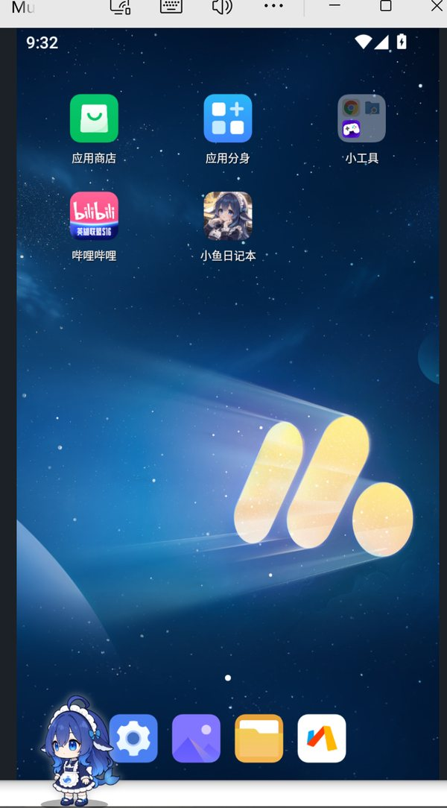
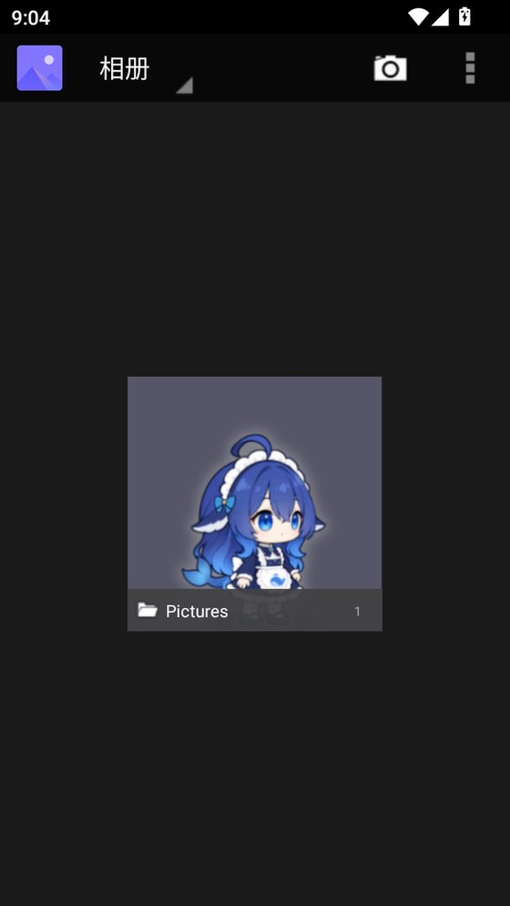

# 她的手机（安卓模拟器）

> 让**她**用一部真的安卓手机：看得见屏幕、会滑、会开任何 App、会搜东西、会刷视频、会在手机上写日记，
> 还会自己找事做。
>
> 需要自己装一个安卓模拟器：**[MuMu 模拟器 12](https://mumu.163.com)**（网易，免费）。
> **本包不附带模拟器**，也不附带 adb（MuMu 自带）。

## 0. 她能干什么

| 能力 | 怎么触发 |
|---|---|
| 看屏幕 | 每一屏都截图（640 宽），加上控件树一起看 |
| 滑 / 翻 | 「往下滑」「往上翻」「翻三屏」 |
| 开任何 App | 「打开菜谱看看」「打开 B 站」「回桌面，打开日记本」 |
| 搜东西 | 「打开浏览器，搜小肥鱼表情包，找一条点进去」 |
| 刷视频 | 「看会儿视频」：读标题 → 抽 3 帧 → 她判 → 想走就上滑 |
| 看相册 | 「去相册挑一张最像你的」 |
| 写日记 | 「去写日记吧」：她先写正文，再敲进手机上的本子 |
| 自己玩 | 需求条满了会先请示你：「我想去 X 看看，行吗」 |

## 1. 装 MuMu

1. 去 <https://mumu.163.com> 下 **MuMu 模拟器 12**（约 1 GB），装到普通目录（例如 `D:\mumulvse\MuMuPlayer`）。
2. 打开 MuMu，**装一台 Android 12 的实例**（默认就是），分辨率 **720×1280** 竖屏最省事。
3. 在模拟器里装几个她会用的 App（可选）：`Via` 浏览器 / 哔哩哔哩 / 相册（系统自带）——
   「打开任何 App」靠的是**按字点图标**，桌面上的名字她认得出多少，就能开多少。
4. **不需要手动开 ADB**：桌宠会问 `MuMuManager.exe` 要 adb 端口。
   如果你改过端口，在 `config\companion.json` 的 `phone.serial` 里写 `127.0.0.1:<端口>`。

> 桌宠找 MuMu 的顺序：环境变量 → `phone.home` → 常见安装目录（`mumulvse\MuMuPlayer`、
> `Program Files\Netease\MuMu Player 12` …）→ 扫盘。找到之后会把路径写回 `phone.home`。

## 2. 装她的日记本（可选，但推荐）

包里已经带了一个签好名的小 APK：**`tools\diary-app\out\her-diary.apk`**（193 KB）。

三种装法，任选一种：

- **拖进去**：把 APK 直接拖到 MuMu 窗口里，按提示点「安装」；
- **双击**：MuMu 装好后双击 APK，会问用哪个模拟器打开；
- **adb**：`D:\mumulvse\MuMuPlayer\nx_main\adb.exe connect 127.0.0.1:16384` 然后
  `adb install -r her-diary.apk`（端口以 MuMu 实际为准）。

装好后桌面上会出现「**她的日记本**」（图标是她自己的头像）。她靠控件上的说明文字读懂怎么用，
不需要教程、不需要模板、不限字数、一天几篇都行，删掉的会进 `trash\`（能捞回来）。

> 想自己改这个 App：源码和 `build.ps1` 在 `tools\diary-app\`（javac → d8 → aapt2 → zipalign → apksigner，
> 不用 Gradle）。`build.ps1` 需要 JDK 和 Android build-tools。

## 3. 打开手机（第三挡）

1. 鼠标悬停在她身上 → 右下角那台**小手机**按钮。
2. 点**第三下**（第一下桌宠大脑、第二下 QQ 聊天、第三下真手机）。
3. 按钮角标先写「**开机**」，30~60 秒后变成「**手机**」；MuMu 窗口会弹出来，摆成 430×900 贴在她旁边。
4. 页面上那块只读小面板会自动收起（不会出现"两个手机"）。
5. 再点一下回到桌宠大脑：在跑的手机会停下。

> **手机不跨重启**：桌宠重开之后手机是关着的（设计如此，避免"能力提示说有手机、页面上却没有"）。
> 要用就再点一次第三挡。

## 4. 她自己怎么用

- **每一屏都看图**：控件树 + 640 宽截图（约 228 token）；图里的猫、照片、视频封面不再因为"树里没有字"被划过去。
- **先想 2~3 步再动手**：一次模型写最多 3 行动作；某一步没让屏幕动，整段作废重想。
- **严格判进展**：只有"目标真的近了 / 换了 App 界面 / 内容大换血"才算前进；屏闪一下不算。
- **不会就换招**：滚动先等沉降，滑不动换大跨度再试，两次都不动才说"到底了"。
- **开 App 的路**：缓存 → 别名 → 当前屏 / 回桌面 / 抽屉里按字点 → **截图问坐标** → **验前台包名**。
  真机「打开菜谱看看」原来 1 秒硬失败，现在能开进去还看一眼。
- **预算**：一趟默认 **20 步 / 180 秒 / 20 次模型调用 / 连续 2 次没反应就收**。
- **做完了会回灌**：她用自己的话（+ 截图）在 QQ 里跟你说；截图只发主人私聊，一小时最多 6 张。

## 5. 她自己玩（不用你叫）

- **需求条 → 想办一件事 → 先请示你 → 你点头就去 → 收尾一条回灌 + 一条日记**；
- 目的地**不写死**：她可以想去哪个 App 就去哪个（看 / 搜 / 写都随她），内容也不固定；
- 每天有**额度**（默认 90 分钟）、冷却分档（顺利 / 一般 / 失败 / 被你喊停）、时段 9:00–23:30
  （22:30 后只读）、21:00 保底一趟；手上的"一件事"跨天带着进度；
- 「去吧」「你随便玩吧」= 许可；「先不要搜了」「我来操作」= 停。
  问句、否定、叙述、"玩手机的触发机制"这类**不会**被当成命令。

## 6. 隐私与风险（请先读）

- **她看得到**：控件树 + 截图（浏览器页面文字、相册缩略图、App 界面）。
  `FLAG_SECURE` 的界面（支付、部分视频）截图是**纯黑**，代码会把 <10 KB 的图当"没截到"。
- **她可能点进付款页**：这是"开放目的地"的代价。兜底是**可追溯 + 你说停就停**。
  不想让她乱跑就把 `phone.autonomy.enabled` 关掉（只在你叫她时动手机）。
- **她拍的东西存在哪**：`data\companion\phone\`（`shots\` 截图、`episodes.jsonl` 每一步、`diary.jsonl` 日记流水）。
- **她写的日记**在模拟器里：`/sdcard/Android/data/com.bluefish.diary/files/diary/`。
- **删掉 `data\companion\phone\`** 只会清掉记录，不会清她手机里的日记。

## 7. 连不上？看这张表

| 症状 | 原因 / 怎么办 |
|---|---|
| 点第三挡只写「开机」，一直不变成「手机」 | MuMu 冷启动要 30~60 秒；超时就点回第一挡再点第三次 |
| 日志写「找不到 MuMu」 | 安装目录不在候选列表里：设置页/配置文件里填 `phone.home`（指向含 `nx_main\` 的那层） |
| `adb connect` 失败 | MuMu 没启动，或者端口变了：`nx_main\MuMuManager.exe adb -v 0` 能打印端口 |
| 她点空 / 一直说"到底了" | 分辨率不是 720×1280 竖屏；或者页面是自绘界面（她的"按字点"对自绘无效） |
| 中文打不进去 | 输入走 `MuMuManager -c input_text`，成功时**不打印任何东西**（判退出码，不是 stdout）；命令失败看 `napcat.log` 同目录的 `pet.log` |
| 她打开的是别的 App | 「打开 X」会**验前台包名**；名字太像时给她一个别名：`config\companion.json` 的 `phone.open.learn` 会自己记，也可以手改 `apps.json` |
| 一句话几件事只做了一件 | 她按小句拆（最多 3 段）；把话说短一点更稳 |
| 她"光说不做" | 看挡位是不是还在第一挡（手机没开）；她手上没手机时会如实说，不会装 |
| 滑块验证过不去 | 现在是"拖一次 → 冷启动 → 还不行就如实认输"，不再硬磨 20 步 |

更多见 [排错](排错.md)。
