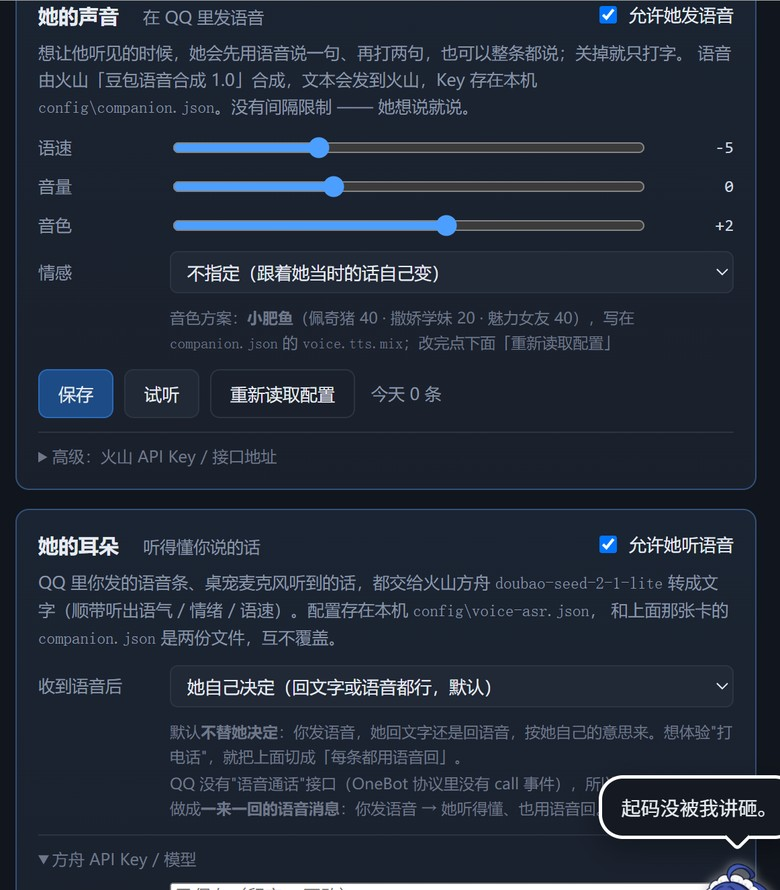

# 语音与耳朵

这里有**三件完全不同的事**，经常被混成一件。先看这张表：

| | 是什么 | 用在哪 | 要什么 | 随包带了吗 |
|---|---|---|---|---|
| **本地语音**（TTS） | 她**在桌面上念出来** | 桌宠气泡、桌宠里打字聊天 | sherpa-onnx + 音色模型（约 150 MB） | ❌ 自己装 |
| **QQ 语音** | 她**在 QQ 里发语音条** | QQ 私聊 | 火山引擎「豆包语音合成 1.0」Key | ❌ 自己填 Key |
| **耳朵**（ASR） | 她**听懂你发的语音** | QQ 语音条、桌宠麦克风、语音对讲 | 火山方舟 Key（`doubao-seed-2-1-lite`） | ❌ 自己填 Key |

三件互相独立：只装本地语音 = 桌面会念、QQ 不会发；只配 QQ 语音 = QQ 会发、桌面还是哑的；
只配耳朵 = 她听得懂你，但可能只打字回。

---

## 1. 本地语音（离线，可选）

**装**（约 40 MB 下载，装好约 150 MB）：

```powershell
powershell -ExecutionPolicy Bypass -File tools\setup-tts.ps1

# 换一个音色（这个音色的许可没有明确标注，自己确认能不能再分发）
powershell -ExecutionPolicy Bypass -File tools\setup-tts.ps1 -Voice fanchen-c
```

它会从 npm 取 `sherpa-onnx-node` + `sherpa-onnx-win-x64`（Apache-2.0），
从 [sherpa-onnx releases](https://github.com/k2-fsa/sherpa-onnx/releases) 取音色模型，装到
`resources\app\vendor\tts\`。**这一步要联网**；装完就完全离线。

- **默认音色 `chaowen`**：CC0 数据集，但它是**男声**（用户原话"像青年男"）。
- **`fanchen-c`**：女声，效果更像她；**许可没有明确标注**，所以没有默认装。
- **验收**：`powershell -File tools\check-runtime.ps1` —— 语音那几行 `MISS` **不算失败**，她只是不会念。
- **删掉**：删 `resources\app\vendor\tts\` 即可，桌宠照常跑。
- **开关**：右键菜单 →「声音」三态（关 / 只有音效 / 音效 + 念出来）；
  设置页「桌宠模型」卡里也有相关开关。

> ⚠️ **这一版不随包提供语音模型**：150 MB 的二进制和模型进不了仓库，`setup-tts.ps1` 一条命令就能装。

## 2. QQ 语音（她在 QQ 里发语音条）

入口：右键她 → 菜单顶部「**音色…**」→ 打开「音色」窗口，最上面那张卡。



### 2.1 填 Key

1. 去 [火山引擎控制台](https://console.volcengine.com/speech/) 开通「**豆包语音合成 1.0**」
   （新版控制台叫「语音合成大模型」），创建应用，拿到 **API Key**。
2. 音色窗口 → 展开「高级：火山 API Key / 接口地址」→ 粘进去 → 保存。
3. 状态会写「已配置」；没配 Key 时她**不会**递话筒，也不会假装发语音。

> 为什么写死 1.0：**只有 1.0 支持混音**，2.0 对 1.0 的音色混音会回空音频。
> 接口是 `https://openspeech.bytedance.com/api/v3/tts/unidirectional`，
> `X-Api-Resource-Id: seed-tts-1.0`。

### 2.2 四个旋钮

| 旋钮 | 默认 | 说明 |
|---|---|---|
| 语速 | -5 | 负数更慢 |
| 音量 | 0 | dB |
| 音色（音调） | +2 | 不是换人，是调音调 |
| 情感 | 不指定 | 跟着她当时的话自己变；固定一种会一直像那个调 |

**音色方案**写在 `config\companion.json` 的 `voice.tts.mix`：默认是她调好的混音
**佩奇猪 40 · 撒娇学妹 20 · 魅力女友 40**。想换配比就改这三个 `factor`（加起来 100 左右），
然后点音色窗口的「**重新读取配置**」，不用重启。

### 2.3 她会怎么用

- **没有每日上限、也没有间隔** —— 想说就说（`stage.minGapMin` / `minTextBetween` 默认 0）。
- **"这条要不要用声音"由场景递话筒**：他要听 100% / 夜里 0.3 / 情绪 0.35 / 她主动 0.7 / 白天 0.04，群里不发。
  **"说什么、哪句说"仍由她写**（她可以整条说、先说一句再打字、说一半打一半，最多 2 段语音）。
- **试听**在音色窗口里直接播，**不发 QQ**。
- **桌宠里她回话要不要念出来**：音色窗口里那个开关（`settings.json` 的 `deskVoice`），
  `cloud` = 用火山那个声音，`local` = 用本机音色（没装本地语音时退回只显示文字）。
- 音色窗口里还有「重新读取配置」和今天的条数。

### 2.4 不配 Key 会怎样

她照样在 QQ 里打字，只是不发语音。桌宠里如果装了本地语音，仍会念（那是另一套嗓子）。

---

## 3. 耳朵（她听懂你说的话）

入口：设置页「她的耳朵」卡。配置在**单独的** `config\voice-asr.json`（和 QQ 语音那份互不覆盖）。

### 3.1 填 Key

1. 去 [火山方舟](https://console.volcengine.com/ark) 开通模型，拿到 **API Key**。
2. 模型默认 `doubao-seed-2-1-lite-260915`（报"模型不存在"就换成控制台里的 `ep-xxxx` 端点 id）。
3. 粘进「她的耳朵 → 方舟 API Key」→ 保存。
4. 点「**测一下耳朵**」：用她自己的嗓子合成一句**已知的话**，再让耳朵听回来 ——
   不需要麦克风、不需要发 QQ，就能验 Key / 模型 / 转写像不像。

### 3.2 三个入口

| 入口 | 怎么用 |
|---|---|
| **QQ 语音条** | 你直接发语音，她转成文字再回；顺手听出语气 / 情绪 / 语速 |
| **桌宠麦克风** | 右键菜单「语音输入」打开（按键收音或自动收音），对着电脑说话 |
| **语音对讲** | 你发语音 → 她听懂 → 也用语音回。⚠️ QQ 协议里**没有"语音通话"接口**（OneBot 没有 call 事件），所以做成"一来一回的语音消息" |

### 3.3 回文字还是回语音

设置页「收到语音后」：

- **她自己决定**（默认）：你发语音，她回文字还是回语音，按她当时的意思；
- **每条都用语音回**：体验"打电话"的感觉（需要 QQ 语音的 Key）。

---

## 4. 费用与隐私

- **本地语音**：完全离线，不花钱、不出本机。
- **QQ 语音**：每次合成会把**要说的文字**发到火山，按字符计费（具体看火山的价格页）。
- **耳朵**：每次识别会把**音频**发到火山方舟。
- 三个 Key 都存在本机：
  `config\settings.json`（桌宠模型）· `config\companion.json`（QQ 模型 + 火山语音）·
  `config\voice-asr.json`（方舟语音识别）。
  **别把 `config\` 提交到公开仓库**（模板里的 Key 都是空的，填过之后就不是了）。
